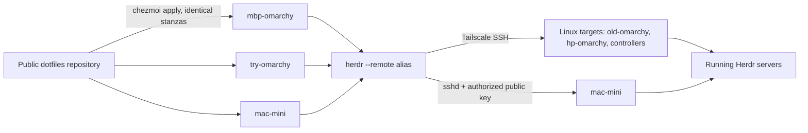

# Herdr remote access

**Status:** Draft
**Created:** 2026-11-18
**Last updated:** 2026-11-18

## Engineering Profile

The stable Engineering Profile is [`PROFILE.md`](PROFILE.md).

### Current-cycle overrides

| Field | Value |
|---|---|
| Cycle | `HERDR-REMOTE-001` |
| Risk | Elevated: changes SSH reachability configuration across five personal hosts and publishes connection topology names to the public repository; no credentials are published |
| Delivery intent | `merge` — feature-branch draft PR into `main` |
| Affected scope | New chezmoi source file `private_dot_ssh/private_config` rendering `~/.ssh/config`; this spec set |
| Changed profile values | None; new context |

## Overview

Any controller host must attach Herdr's TUI to any target host's Herdr
server with one stable command — `herdr --remote <alias>` — using identical
aliases everywhere. One chezmoi-managed SSH configuration provides the
aliases; authentication rides the existing private tailnet without shipping
key material through the public repository.

Controllers: `mbp-omarchy` (Omarchy laptop), `try-omarchy` (Omarchy VM),
`mac-mini` (macOS host). Targets: the controllers themselves plus
`old-omarchy` and `hp-omarchy` (Linux hosts). Deferred alias:
`seo-semote-dev`.

## File Map

| Path | Purpose |
|------|---------|
| `private_dot_ssh/private_config` | chezmoi source rendering `~/.ssh/config`, mode 600 |
| `~/.ssh/config` (rendered) | Alias stanzas consumed by OpenSSH and therefore by `herdr --remote` |
| `docs/specs/herdr_remote_access/` | This spec set, plan, backlog, changelog |

## Architecture

Identical `~/.ssh/config` on every controller. Each alias stanza maps an
operator-facing alias to a tailnet host and user. `herdr --remote <alias>`
delegates connection to OpenSSH, so alias resolution, not Herdr, owns the
targeting. Two authentication paths: Tailscale SSH for Linux targets, plain
sshd with operator-authorized public keys for the macOS target, where
Tailscale's SSH server is unavailable.

## Domain

### Bounded Context

Herdr remote attach over the private tailnet, owned by the dotfiles
repository. Adjacent: chezmoi bootstrap, Herdr itself, Tailscale
administration — each externally owned and unchanged here.

### Entities

- **ControllerHost** — host whose operator initiates `herdr --remote`.
- **TargetHost** — host whose Herdr server is attached; every target is
  also reachable as a target from the other controllers.
- **SshAlias** — stable operator-facing name in the managed config.
- **TailnetIdentity** — the target's MagicDNS host name on the private
  tailnet.
- **RemoteHerdrServer** — the per-host Herdr server that `--remote`
  attaches to but never starts.

### Value Objects

- **AliasStanza** — one `Host` block: alias, optional `HostName` when alias
  differs from the tailnet name, and `User`.
- **AuthPath** — `tailscale_ssh` or `sshd_public_key`; a property of the
  target platform, never of the stanza.

### Domain Events

- `AliasSetApplied` — chezmoi apply rendered the identical alias set on a
  controller.
- `RemoteAttachSucceeded` / `RemoteAttachFailed` — `--remote` reached (or
  failed to reach) a running remote Herdr server.

### Ubiquitous Language

| Term | Definition |
|------|-----------|
| controller | Host an operator attaches from |
| target | Host being attached to; controllers are targets for each other |
| alias | Operator-facing `Host` name in the managed config |
| tailnet name | MagicDNS host name resolving only inside the private tailnet |
| remote attach | `herdr --remote <alias>` opening the TUI against a target's server |

## Behavior Scenarios

### Feature: Uniform remote attach

**Scenario: Attach from any controller**
- Given a controller with the managed alias set applied
- And the alias's target is online with its Herdr server running
- When the operator runs `herdr --remote <alias>`
- Then OpenSSH resolves the alias through the managed config
- And the TUI attaches to that target's Herdr server.

**Scenario: Target server not running**
- Given a reachable target whose Herdr server is not running
- When the operator runs `herdr --remote <alias>`
- Then attach fails with a connection error
- And no remote server is started by the attempt.

**Scenario: Self-referential alias**
- Given a controller whose own alias names its own tailnet identity
- When the operator runs `herdr --remote <own-alias>`
- Then the controller connects to itself over the tailnet without error.

### Feature: Distribution

**Scenario: Bootstrap a new controller**
- Given a controller bootstrapped from the shared source
- When chezmoi apply runs
- Then every alias stanza is rendered into `~/.ssh/config` with mode 600
- And the stanza set is identical on all controllers.

**Scenario: Adoption over pre-existing local config**
- Given a host that already has an unmanaged `~/.ssh/config`
- When first apply would render the managed file
- Then pre-existing operator content is preserved or the adoption is
  explicitly approved — never silently discarded.

### Feature: Authentication without shipped credentials

**Scenario: Linux target**
- Given a Linux target with Tailscale SSH enabled
- When a controller connects through the alias
- Then authentication is owned by the tailnet and no key material exists
  in the repository.

**Scenario: macOS target**
- Given the macOS target where Tailscale's SSH server is unavailable
- When a controller connects through the alias
- Then plain sshd authenticates the operator-authorized public key of that
  controller.

### Feature: Alias governance

**Scenario: Alias differs from tailnet name**
- Given aliases deliberately distinct from tailnet names
  (`try-omarchy`, `hp-omarchy`)
- When OpenSSH resolves them
- Then each stanza's `HostName` is the authoritative tailnet name and the
  mapping lives in exactly one place.

**Scenario: Deferred alias**
- Given an alias not yet defined in the managed config
- When the operator references it
- Then resolution fails locally and adding the stanza later is additive.

## Interfaces & Contracts

### Managed config file
- **Pre:** no managed `~/.ssh/config` on the host, or adoption approved.
- **Post:** rendered file contains exactly the approved alias stanzas,
  mode 600, directory 700.

### Alias stanza set
- **Invariant:** every stanza sets `User`; every alias whose name differs
  from its tailnet name declares `HostName`; no wildcard stanza exists;
  no credential-bearing directive (`IdentityFile`, `ProxyCommand` with
  secrets, `PasswordAuthentication`) exists in source.
- **Invariant:** the stanza set is byte-identical across controllers —
  per-host divergence is a defect.

### Remote attach
- **Pre:** target online on the tailnet and its Herdr server running.
- **Post:** attached TUI; the attach never installs, starts, or restarts a
  remote server.

## Visual Evidence

| Concern | Decision | Review question | Canonical source |
|---|---|---|---|
| Boundary | `required: attach topology flowchart` | Which controllers reach which targets, through which auth path? | Architecture, Interfaces |
| Interaction | `not_applicable` | Single synchronous SSH attach; no ordering, retry, or approval handoff | Behavior |
| State | `not_applicable` | Only server running/not-running, owned by prose | Behavior |
| Data/trust | `required: attach topology flowchart` | What crosses the public-repo/private-tailnet boundary? | PROFILE trust boundaries |
| Schema | `not_applicable` | Flat alias stanzas; no entity model | Interfaces |
| Dependency/deployment | `required: attach topology flowchart` | How do aliases and auth prerequisites reach each host? | Distribution feature |
| Quantitative | `not_applicable` | No quantitative decision evidence | Validation |



**Text Equivalent:** The public repository carries only alias stanzas and
bare tailnet host names — no credentials, key material, addresses, or the
tailnet domain. chezmoi apply renders the identical stanza set on all three
controllers. `herdr --remote <alias>` resolves through OpenSSH to one
target. Linux targets authenticate through Tailscale SSH; the macOS target
through plain sshd with each controller's operator-authorized public key.
Attach succeeds only against an already-running remote Herdr server. Owner:
dotfiles maintainer; update when controllers, targets, or auth paths
change.

## Gate Ledger

| Gate | Capability | Applicability | Result | Authority/evidence | Exception | Owner |
|---|---|---|---|---|---|---|
| Domain | kernel | required | pending | this README | — | primary |
| Behavior | kernel | required | pending | scenarios above | — | primary |
| Spec | kernel | required | pending | this README + PROFILE.md | — | primary |
| Contract | kernel | required | pending | Interfaces & Invariants | — | primary |
| Test-driven implementation | kernel | required | pending | ssh -G probes, chezmoi diff/apply, mode check | — | primary |
| Refactor | kernel | required | pending | diff review | — | primary |
| Review/Integrate | completion | required | pending | PR diff coherence, CI | — | primary |
| Release | completion | not_applicable: managed configuration, no versioned artifact | not_run | — | — | — |
| Deploy | completion | required: chezmoi apply on controllers + runbook enablement | pending | apply evidence per controller | — | primary |
| Operate | completion | required: live attach smoke per target | pending | herdr --remote evidence | — | primary |
| Maintain/Retire | completion | required: alias drift and host retirement | pending | backlog discipline | — | primary |

## Validation

```bash
# Offline: alias resolution and stanza integrity (no network)
ssh -G try-omarchy | grep -E '^(hostname|user) '
ssh -G hp-omarchy   | grep -E '^(hostname|user) '
ssh -G old-omarchy  | grep -E '^(hostname|user) '
ssh -G mbp-omarchy  | grep -E '^(hostname|user) '
ssh -G mac-mini     | grep -E '^(hostname|user) '
stat -c '%a' ~/.ssh ~/.ssh/config   # expect 700 / 600

# Repository
chezmoi diff          # rendered intent
pytest -q             # repository suite
```

Live smoke (operator, one command per target, after each target's Herdr
server has been started once): `herdr --remote <alias>` attaches.

## Facts, Assumptions, Risks

**Facts (observed 2026-11-18).** All target tailnet identities are online.
`try-omarchy` runs Tailscale SSH already. `mbp-omarchy` runs sshd with
Tailscale SSH disabled. `mac-mini` runs Remote Login. Herdr 0.9.5 on
`mbp-omarchy` supports `--remote` and machine profiles. No `~/.ssh/config`
exists on `mbp-omarchy`; other hosts unverified.

**Assumptions.** Herdr is installed on `old-omarchy`, `hp-omarchy`, and
`mac-mini` (operator-confirmed for `mac-mini`). macOS username on
`mac-mini` matches the Linux one. Remaining hosts lack a pre-existing
`~/.ssh/config`; adoption check protects the assumption.

**Accepted risks.** Publishing generic host aliases and bare tailnet names
in the public repository (operator decision; no addresses or domain
published).

**Non-goals.** `seo-semote-dev` alias (deferred), Tailscale SSH enablement
as repository state, sshd hardening, tailnet ACL changes, key distribution,
host provisioning.

## Artifact Review

- README: created — new bounded context.
- PROFILE: created — stable defaults for the context.
- BACKLOG: created — HERDR-REMOTE-001 active.
- CHANGELOG: created — completion entry required at cycle close.

## Gotchas

- `--remote` attaches only; it never starts a remote server. Fresh target
  needs `ssh -t <alias> herdr` once.
- Two aliases intentionally differ from tailnet names; the `HostName` map
  is the single source of truth.
- Managing `~/.ssh/config` makes chezmoi own the whole file; future manual
  edits on any host will show as drift.
- Tailscale's SSH server cannot run on macOS; that target keeps plain
  sshd and per-controller authorized keys.
