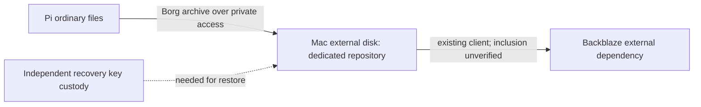

# Homelab versioned backup

Status: Implemented and deployed. Encrypted remote archive, isolated restore,
retention, daily scheduling and fresh startup verified. Source and deployment are maintained in dotfiles.

## Intent and ownership

Protect Pi ordinary files with encrypted, versioned backups, then let the Mac's
existing Backblaze client protect the local repository. Reuse the Borg/borgmatic
family already deployed on HP; preserve the HP repository and timer. This is
recovery rather than synchronization. No formatting, existing data replacement,
Backblaze purchase, database deployment or automatic workload moves are included.

## Engineering Profile

Operator-owned internal infrastructure. Fedora ARM64 backup client; macOS
destination on an existing APFS external disk; Borg 1.x compatibility must be
verified on both ends. Cloud and Security modules apply; elevated risk.
Personal dotfiles owns scripts/configuration, while passwords, encryption keys,
connection bindings and disk UUIDs stay private. Kernel, review, deploy, operate
and maintenance gates are required. Release is not applicable: no
package is published. Authorities: scoped pytest, shell checks, mount identity
validation, Borg repository checks and isolated file restore comparison.

## Behaviors and contracts

- Given the expected destination disk is mounted, a backup creates an encrypted
  archive without modifying the source or unrelated destination folders.
- Given the disk is absent or substituted, backup fails before writing; it must
  not fall back to the Mac's internal filesystem.
- Given an unavailable Mac or tailnet, the job reports failure and retries on a
  later scheduled run; it does not delete prior archives.
- Given an overlapping job, one writer proceeds; duplicate writers fail safely.
- Given backup validation failure, retention pruning does not run.
- Given a selected archive, restore into an isolated directory produces matching
  file contents; restoration never overwrites live data implicitly.

Repository folder: `Homelab-Backups/pi400` under the dedicated external
disk. Public declarations use logical disk identity only. Bind the actual UUID
privately and check it at the destination, including remote writes. Declared
schedule matches HP: daily, with 7 daily, 4 weekly and 6 monthly archives.
The Pi pushes archives over existing Mac SSH using a newly generated dedicated
Pi identity and a restricted forced command on the destination. The forced
command checks the mounted filesystem UUID before starting Borg, then restricts
access to this repository only. Existing Mac SSH identities remain unchanged.
Never reuse or copy the Mac's private administration key onto the Pi.
Repository passwords and exported recovery keys must be kept independently of
the Pi, repository and sole Mac copy. Use a restricted backup identity rather
than unrestricted remote shell credentials. Existing Mac SSH and Borg 1.4.5 are
available. Public host keys are verified from the owned destination before trust
is installed; no private keys are copied.

Backblaze inclusion and a cloud restore must be verified separately. A successful
Borg job is not evidence of cloud protection. Concurrent edits give file-level
copies, not transactional snapshots; databases require separate consistent dumps.
Initial scope is ordinary shared files plus declared configuration inventories.
RustFS object data has independent consistent-backup obligations; this ordinary
file slice must not falsely claim active object/database consistency.

## Visual Evidence

Boundary, data/trust and deployment are required and represented below.
Interaction and state use this transition contract: destination verified,
archive created, archive checked, retention allowed. Failures stop the sequence.
Schema and quantitative are not applicable: no application schema or performance
benchmark is introduced.

**Text Equivalent:** Pi files are archived to a dedicated encrypted repository on
the Mac-connected disk. Existing Backblaze supplies a separate offsite layer only
after inclusion is verified. Independent key custody is required for restoration.
Canonical source is this contract; operator updates it when recovery paths change.

## Concrete interfaces

The maintained standard-library Python CLI `homelab-backup` supports destination
planning/initialization on macOS and client planning/run/restore checks on Fedora.
Python 3.12+ is supported. Private JSON configuration names exact destination
volume UUID, mount, repository, connection identity and password-file locations.
Public source never embeds that configuration. The destination SSH forced command
is `homelab-borg-serve`; it verifies the mount before executing Borg restricted to
the declared repository. Client execution uses a private dedicated SSH key and
strict host-key checks; the key is generated on Pi and never copied from Mac.

Package prerequisites are explicit: macOS Borg 1.4.x, Fedora borgbackup/borgmatic.
A declared systemd user timer runs daily and catches missed runs. Setup refuses
symlinks, unknown existing repositories and substituted mounts. No service, key
or repository is initialized by an ordinary chezmoi apply. Secret generation and
runtime enrollment are explicit commands, with private files and no secret output.

Normal archive creation runs an integrity check before retention. A failed create
or check stops before pruning. The first test archive is restored into an isolated
directory and compared before unattended scheduling is enabled.

Record last success, archive age, repository identity, disk headroom and errors.
Verify a small file restore before enabling pruning. Establish periodic integrity
checks and restore drills. Keep backup configuration independent of desktop
profiles. Stop scheduling to retire a source; retain archives until explicit
operator-approved expiry. Never delete the only verified recovery copy.

## Verified deployment and limitations

Borg 1.4.5 runs on both ends. A new backup-only key was generated on Pi; the Mac
accepts it only from that tailnet node, with a restricted forced command and no
forwarding or general shell access. Existing identities were preserved. The
destination verified the exact APFS mount identity before repository writes.
Missing/substituted disk and symlink guard tests passed. The volume root required
owner-entered sudo to create only the absent dedicated folder; disk root ownership
and existing contents were not changed.

The first encrypted archive restored a unique test file into a private temporary
directory; bytes matched. Retention remained disabled until that restore passed.
Normal create/check/prune/compact passed. The timer survived a fresh reboot and
ran its catch-up job successfully. CPU is capped at half a core equivalent,
memory at 1 GiB, with low scheduling priority. No sustained throughput or large
archive capacity guarantee is made.

Backblaze metadata confirms the existing external drive is selected. Discovery
of the new repository in its scan and cloud upload/restore are not yet verified;
no offsite recovery guarantee is claimed. This does not weaken the verified local
encrypted archive/restore. The operator must confirm cloud upload and test a
cloud restore before treating that layer as established.

## Maintained setup, update and recovery

Private `destination.json` records mount, UUID, dedicated repository, recovery
file locations, Pi administration binding and Mac tailnet identity. Private
`client.json` records repository, dedicated identity, trust, password-file and
source folders. These bindings and recovery files are excluded from chezmoi and
Git; public `policy.json` records package and retention choices.

Explicit setup order: install declared Borg packages; create only the absent
dedicated owner folder if volume permissions require sudo; run destination plan
and initialize; enroll client identity/trust with `enroll-client`; install client
helper; run client plan and restore-check; then enable the declared timer. These
commands are repeatable except repository initialization, which deliberately
refuses an existing repository. Enrollment preserves matching private files and
refuses conflicting material. Restore a known configuration rather than deleting
partial state blindly.

On Mac, use `homelab-backup destination-plan --config` with the private destination
binding before changes. On Pi, `homelab-backup restore-check --config` exercises
recovery and `run --config` executes a checked archive with retention. Inspect
`systemctl --user list-timers pi-backup.timer`, the oneshot result and private
`last-success.json`. Timer/source updates use selective chezmoi application from
a reviewed revision; do not apply unrelated desktop/work/AI targets.

Private recovery material is under the Mac owner's configuration directory,
outside the backup disk; the passphrase also exists privately on Pi. Save the
exported repokey and passphrase into independent secure custody before relying on
disaster recovery. Neither is displayed by setup. After Pi replacement, rebuild
from declared Fedora bootstrap, restore ordinary files into an isolated location,
enroll a fresh restricted identity and revoke the lost identity explicitly.
After Mac/disk failure, restore the complete repository and independent recovery
material; run integrity and isolated restore checks before resuming retention.
During a disk-full incident, local Mac restoration remains available while the
remote guard refuses new sessions until headroom is recovered.

Initial backups cover Shared and declared Samba configuration, not a full system
image, root-owned SMB identity database, databases or live RustFS objects. Recreate
service identities through explicit private enrollment after a rebuild.
