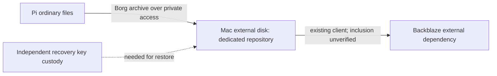

# Homelab versioned backup

Status: Discovery. Operator approved Borg backups from Pi to a dedicated folder
on the existing Mac-connected 8 TB disk. Implementation is pending.

## Intent and ownership

Protect Pi ordinary files with encrypted, versioned backups, then let the Mac's
existing Backblaze client protect the local repository. Reuse the Borg/borgmatic
family already deployed on HP; preserve the HP repository and timer. This is
recovery rather than synchronization. No formatting, existing data replacement,
Backblaze purchase, database deployment or automatic workload moves are included.

## Engineering Profile

Operator-owned internal infrastructure. Fedora ARM64 backup client; macOS
destination on an existing APFS external disk; Borg 1.x compatibility must be
verified on both ends. Cloud and Security modules apply; elevated risk.
Personal dotfiles owns scripts/configuration, while passwords, encryption keys,
connection bindings and disk UUIDs stay private. Kernel, review, deploy, operate
and maintenance gates are required and pending. Release is not applicable: no
package is published. Authorities: scoped pytest, shell checks, mount identity
validation, Borg repository checks and isolated file restore comparison.

## Behaviors and contracts

- Given the expected destination disk is mounted, a backup creates an encrypted
  archive without modifying the source or unrelated destination folders.
- Given the disk is absent or substituted, backup fails before writing; it must
  not fall back to the Mac's internal filesystem.
- Given an unavailable Mac or tailnet, the job reports failure and retries on a
  later scheduled run; it does not delete prior archives.
- Given an overlapping job, one writer proceeds; duplicate writers fail safely.
- Given backup validation failure, retention pruning does not run.
- Given a selected archive, restore into an isolated directory produces matching
  file contents; restoration never overwrites live data implicitly.

Candidate repository folder: `Homelab-Backups/pi400` under the dedicated external
disk. Public declarations use logical disk identity only. Bind the actual UUID
privately and check it at the destination, including remote writes. Candidate
schedule matches HP: daily, with 7 daily, 4 weekly and 6 monthly archives.
Repository passwords and exported recovery keys must be kept independently of
the Pi, repository and sole Mac copy. Use a restricted backup identity rather
than unrestricted remote shell credentials. Direction and credential enrollment
are finalized after checking macOS SSH availability; no private keys are copied.

Backblaze inclusion and a cloud restore must be verified separately. A successful
Borg job is not evidence of cloud protection. Concurrent edits give file-level
copies, not transactional snapshots; databases require separate consistent dumps.
Initial scope is ordinary shared files plus declared configuration inventories.

## Visual Evidence

Boundary, data/trust and deployment are required and represented below.
Interaction and state use this transition contract: destination verified,
archive created, archive checked, retention allowed. Failures stop the sequence.
Schema and quantitative are not applicable: no application schema or performance
benchmark is introduced.

**Text Equivalent:** Pi files are archived to a dedicated encrypted repository on
the Mac-connected disk. Existing Backblaze supplies a separate offsite layer only
after inclusion is verified. Independent key custody is required for restoration.
Canonical source is this contract; operator updates it when recovery paths change.

## Operations and retirement

Record last success, archive age, repository identity, disk headroom and errors.
Verify a small file restore before enabling pruning. Establish periodic integrity
checks and restore drills. Keep backup configuration independent of desktop
profiles. Stop scheduling to retire a source; retain archives until explicit
operator-approved expiry. Never delete the only verified recovery copy.
