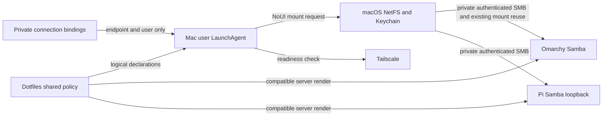

# Central Samba policy and macOS reconnect

Status: Discovery ready; implementation and deployment await exact launch
approval. Owner: personal dotfiles operator. Bounded context:
`homelab_file_storage`; topology, backups and AI configuration remain adjacent.

## Outcome and scope

Maintain one source of shared Samba security/settings for Pi and Omarchy. Keep
existing installed configuration paths as thin renders of that source so current
provisioning commands stay compatible. A central public-safe logical catalog
includes Pi and HP Omarchy, plus the Omarchy ARM guest as a declared/manual
entry with deployment unverified. Catalog inclusion does not provision a new VM
share or claim availability. Pi and HP Omarchy both reconnect by default on
the administration Mac. The Omarchy ARM guest remains manual with deployment
unverified. Reuse existing Pi and HP mounts; do not create duplicate mounts.
macOS native file-sharing exports are outside this Samba ownership migration.

No share root moves, existing-file deletion, disk formatting, credential changes,
public exposure, Tailscale toggle, router changes or workload migration occurs.
Pi remains loopback Samba through private Tailscale Serve TCP 445. Omarchy keeps
its current authenticated private-LAN plus Tailscale access. Both expose only
owner Shared folders, with SMB2+, no guest access, NetBIOS or printing, and
0600/0700 file/directory masks.

## Domain and interfaces

A Share Declaration identifies a logical target, share name, server policy and
client reconnect default. Server Policy owns common Samba settings and explicit
transport differences. Connection Binding supplies an endpoint and username
privately; it contains no password. Mounted Share is identified by actual
server/share metadata, never by an ambiguous Shared or Shared-1 directory name.
Reconnect Attempt is a bounded, serialized per-user operation.

Source design: one `.chezmoidata/` declaration and `.chezmoitemplates/` Samba
renderer; existing Pi and Omarchy source files become thin wrappers. A macOS
catalog under `~/.config/samba/`, a maintained `~/.local/bin/smb-shares` helper
and an Aqua user LaunchAgent implement client access. Private connection
bindings under `~/.config/samba/` are unmanaged, owner-only files; they are never
committed. Existing homelab access bindings may seed Pi's endpoint locally but
are not expanded into public source. The helper offers read-only plan/status,
explicit private binding enrollment, one reconnect pass and explicit launchd
activation/removal. Final command shapes are settled during the Spec gate.

The launchd job uses RunAtLoad and a 60-second StartInterval. It has no KeepAlive
network-state dependency, privileged helper or password in ProgramArguments.
The helper checks Tailscale is Running and the intended tailnet peer/SMB endpoint
is reachable before mounting. It does not change Tailscale configuration.
Native NetFS uses NoUI and system-managed credentials; passwords never cross
Python, command arguments, environment, configuration or logs. A separate
bounded worker limits native mount calls for each target independently. Missing
credentials result in a safe status and later retry, never an automatic password
dialog.

Use default NetFS /Volumes placement. Detect already mounted shares through
native mount metadata and reuse exact identities, preserving current HP and Pi
mounts. No forced unmount, destructive mountpoint replacement, local fallback
folder or password-bearing URL is permitted. A still-mounted session is left
for macOS recovery; this job is not authorized to force recovery of busy or stale
open handles. Missing or ambiguous identity fails closed rather than mounting a
duplicate or returning another host's Shared folder.

## Behavior

- Given a healthy existing Pi or HP Omarchy mount, repeated reconnect passes
  reuse it and do not create duplicate mounts.
- Given either enabled share is absent, usable saved SMB credentials and a
  reachable Tailscale peer, the next scheduled pass mounts that share without a
  password dialog. A failure or offline peer for one target does not suppress
  the other target's independent bounded attempt.
- Given Tailscale is stopped, peer is offline, TCP 445 is unavailable or saved
  credentials are missing, the pass records a safe logical status and retries
  later without changing networking, credential state or existing mounts.
- Given a macOS login or wake, launchd runs the same bounded idempotent pass;
  a missed timer while asleep may run after wake according to launchd behavior.
- Given malformed/private-file permissions, unsupported catalog values,
  endpoint mismatch, concurrent invocation or unknown mount identity, no unsafe
  mount, credential disclosure or unrelated state change occurs.
- Given Pi and Omarchy are rendered from the central server policy, their
  existing access boundaries and installed provisioning paths remain compatible.
- Given an operator removes the reconnect job, future retries stop while
  mounted shares, server configuration, files and saved credentials remain.

## Contracts and validation

Python runtime is 3.12+ with no additional dependency. Private files are bounded
regular owner files, reject symlinks and unsafe permissions, validate exact
fields and do not permit password-bearing URLs or arbitrary executable paths.
Network probes, subprocesses and native mounting are bounded. One process owns
a per-user lock; no parallel duplicate retries. Logs/status expose only logical
IDs and fixed result classes, with private permissions and bounded retention.

Regression tests precede implementation for profile isolation, central rendering
and preserved policy, malformed bindings, offline/missing-credential behavior,
mount identity/collisions, bounded retries and idempotence. Configured pytest,
chezmoi, shell/plist syntax and focused diff/privacy review are authorities.
No dedicated publication scanner is configured; reuse scoped public/private
source tests and diff review rather than inventing a second denylist.

Live validation selectively installs exact reviewed source with unrelated chezmoi
scripts excluded. Verify Pi server configuration parity, SELinux and exposure,
macOS launchd job, repeated no-op pass and isolated SMB upload/download. One
graceful unmount/remount per exact enabled share, sequentially and only when
not busy, may verify noninteractive reconnect; never force it. Preserve all
unrelated mounts and SSH, S3, Git, backup and remote-desktop connectivity. A fresh
macOS login is not claimed unless separately observed. Existing-session success alone does not
prove persistent Keychain enrollment. Credentials saved against an older LAN
address may require one private Finder enrollment for the canonical Tailscale
name; never copy or extract the password to work around that requirement.

## Visual Evidence

Boundary: required, shared policy, servers and client shown below. Data/trust:
required, passwords stay in Samba/Keychain. Dependency/deployment: required,
per-user launchd depends on native NetFS and Tailscale. Interaction/state:
required, transition table below. Schema: not applicable, no application data
schema; small config shapes are specified in prose. Quantitative: not
applicable, no throughput or timing performance claim is made.

**Text Equivalent:** Dotfiles is the common server-policy owner and renders
compatible inputs for Pi's private loopback service and Omarchy's existing
service. The Mac user agent combines public logical declarations with private
endpoint/user bindings, checks Tailscale, then requests noninteractive NetFS
mounts using system-managed authentication. Pi and HP Omarchy are default
reconnect targets; both existing mounts are preserved and reused. Passwords
remain in Samba and Keychain.
Canonical source: this contract and the central declarations. Owner: personal
dotfiles operator. Update this visual when ownership, transport or retry flow
changes.

| Current state | Guard/event | Outcome |
| --- | --- | --- |
| Waiting | Invalid binding or no Tailscale | Safe status; no mount; later retry |
| Waiting | Peer/port unavailable | Safe status; existing mounts preserved |
| Waiting | Exact share already mounted | Reuse; no duplicate |
| Waiting | Ready and missing mount | One bounded NoUI native request |
| Mounting | Authentication unavailable/error/timeout | Safe status; later retry |
| Mounting | Identity verified | Mounted; next pass reuses it |
| Any | Reconnect disabled | Stop future attempts; preserve mounts and data |

**Text Equivalent:** Every pass first validates bindings and readiness. An exact
existing mount is reused. Only a ready missing share enters one bounded native
mount attempt. Authentication failure, timeout or unavailable peer causes a safe
waiting state; a verified mount becomes reusable. Disabling the job stops future
attempts without removing data or mounts. Canonical source: behavior and
contracts above; operator owns updates when guards or retry semantics change.

## Deployment, rollback and maintenance

Preview selected files and policy parity before applying. Server candidates
must pass testparm. Byte-equivalent server renders require no service restart.
If a privileged system configuration change proves necessary, ask privately for
sudo and preserve the old configuration before activation. Do not restart or
change a service merely to centralize equivalent source.

Rollback boots out only the new per-user reconnect job, restores its backed-up
public helper/config files and restores the prior source revision. Do not
unmount another share, remove credentials, delete user files or reset Serve.
Observe sanitized per-share state, retry age and server/mount health; investigate
repeated authentication failures through private Finder enrollment. Maintain
supported macOS, Python, Samba and Tailscale; review behavior after OS upgrades.
Retirement disables the user job and preserves data/credentials until the owner
explicitly authorizes their independent removal.
