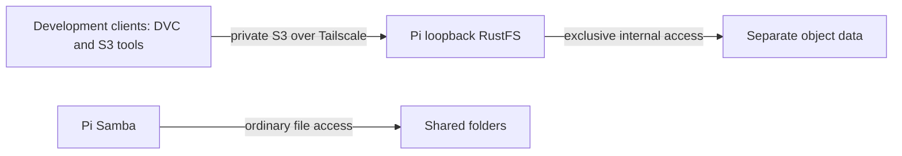

# Private Pi S3 development storage

Status: Discovery. Operator requested RustFS on Pi for DVC workflows. Official
ARM64 release was downloaded, checksum-verified and its CLI inspected in private
staging. No RustFS service or data store has been activated.

## Intent and boundaries

Expose a private S3-compatible development endpoint while preserving ordinary
Samba folders. Object storage is a distinct ownership boundary: no client or
Samba service edits RustFS's internal files directly. Baserow, public access,
production guarantees and existing project migration are non-goals. Existing
topology records hosting; independent backup owns recovery destinations.

Engineering defaults are in PROFILE.md. Personal dotfiles owns the declaration;
the operator owns credentials, lifecycle and private endpoint bindings.

## Behavior

- Given a checksum-matching ARM64 release, explicit setup installs it without
  replacing an unknown existing binary or data directory.
- Given a private owner identity, S3 put/get/list/delete succeeds and downloaded
  bytes match; anonymous object operations are denied.
- Given existing Tailscale routes, setup adds only dedicated S3 forwarding and
  refuses an incompatible route rather than resetting configuration.
- Given resource contention, declared service limits constrain S3 without
  removing Samba access or consuming unbounded disk space.
- Given logout or reboot, the enabled service returns without interactive login.
- Given an upgrade failure, the previous binary/configuration remains available;
  data is preserved and format compatibility is checked before rollback.

## Candidate interfaces and contracts

Pin RustFS 1.0.1, official `rustfs-linux-aarch64-gnu-v1.0.1.zip`, SHA-256
`1dcfb6ae59702b8e90394157e57450ed219515a1cc63525f730d4e120e9be7b9`.
The verified binary reports ARM64 Linux and git commit
`6de965ae3c965a78ff819fbcd7acd4aa44177d92`.

Run as the owner, bind S3 to loopback TCP 9000, and forward that port privately
through Tailscale. The web console is optional and loopback-only by default.
Use separate generated credential files via RustFS's access-key-file and
secret-key-file options; never pass credentials in process arguments or logs.
Keep files private, reusable on rerun and independently recoverable.

Candidate limits: one CPU equivalent, MemoryHigh 1536 MiB, MemoryMax 2 GiB,
MemorySwapMax zero. These are experimental bounds, not measured requirements.
Native development operation avoids adding a container runtime solely for S3.
Use an isolated object directory under owner-managed local data, not Shared.
Check disk headroom before activation and expose health/usage observations.

DVC integration uses an isolated scratch project and dedicated test bucket.
Credentials stay in private local configuration; no existing DVC remotes, work
cloud credentials or data caches are changed. Test push/pull is a separately
approved external write included explicitly in the launch plan. S3 protocol
compatibility remains unverified until that roundtrip succeeds.

## Visual Evidence

Boundary, data/trust and deployment are required and represented below.
Interaction and state use the ordered rollout contract: verify payload, preview,
install, enroll private forwarding, health/auth tests, DVC roundtrip, fresh boot.
Failures preserve data and stop rollout. Schema is not applicable because no
application schema is introduced. Quantitative is not applicable: limits are
declarations, not benchmark claims.

**Text Equivalent:** Development clients access RustFS through private Tailscale
S3 forwarding. RustFS exclusively manages its object data. Samba separately
exposes ordinary Shared folders. Canonical source is this contract; operator
updates it when hosting, protocols or ownership changes.

## Operations and recovery

Observe service health, memory pressure, restarts, disk free space and concurrent
SMB/S3 latency. Do not equate successful small transfers with sustained capacity.
Back up object data consistently with service stopped or an upstream-supported
mechanism, including recovery credentials. Validate restore before storing
irreplaceable objects. Retention, upgrade compatibility and data disposal require
explicit owner decisions. Removing a service never deletes its data implicitly.

Sources: [RustFS project](https://github.com/rustfs/rustfs),
[container deployment characteristics](https://docs.rustfs.com/en/installation/container),
[DVC S3 interface](https://doc.dvc.org/user-guide/data-management/remote-storage/amazon-s3).
