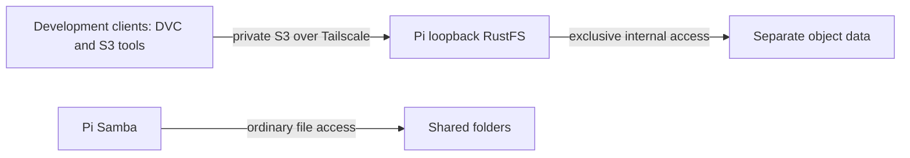

# Private Pi S3 development storage

Status: Implemented and deployed. Signed S3, isolated DVC push/fresh-cache pull,
private-only listeners, limits and fresh startup verified. Source and deployment are maintained in dotfiles.
No production capacity claim is made.

## Intent and boundaries

Expose a private S3-compatible development endpoint while preserving ordinary
Samba folders. Object storage is a distinct ownership boundary: no client or
Samba service edits RustFS's internal files directly. Baserow, public access,
production guarantees and existing project migration are non-goals. Existing
topology records hosting; independent backup owns recovery destinations.

Engineering defaults are in PROFILE.md. Personal dotfiles owns the declaration;
the operator owns credentials, lifecycle and private endpoint bindings.

## Behavior

- Given a checksum-matching ARM64 release, explicit setup installs it without
  replacing an unknown existing binary or data directory.
- Given a private owner identity, S3 put/get/list/delete succeeds and downloaded
  bytes match; anonymous object operations are denied.
- Given existing Tailscale routes, setup adds only dedicated S3 forwarding and
  refuses an incompatible route rather than resetting configuration.
- Given resource contention, declared service limits constrain S3 without
  removing Samba access while disk headroom is checked before installation. There is no disk quota;
  the operator monitors free space during use.
- Given logout or reboot, the enabled service returns without interactive login.
- Given an upgrade failure, the previous binary/configuration remains available;
  data is preserved and format compatibility is checked before rollback.

## Interfaces and contracts

Pin RustFS 1.0.1, official `rustfs-linux-aarch64-gnu-v1.0.1.zip`, SHA-256
`1dcfb6ae59702b8e90394157e57450ed219515a1cc63525f730d4e120e9be7b9`.
The verified binary reports ARM64 Linux and git commit
`6de965ae3c965a78ff819fbcd7acd4aa44177d92`.

Run as the owner, bind S3 to loopback TCP 9000, and forward that port privately
through Tailscale. The web console is optional and loopback-only by default.
Use separate generated credential files via RustFS's access-key-file and
secret-key-file options; never pass credentials in process arguments or logs.
Keep files private, reusable on rerun and independently recoverable.

Declared limits: one CPU equivalent, MemoryHigh 1536 MiB, MemoryMax 2 GiB,
MemorySwapMax zero. These are experimental bounds, not measured requirements.
Native development operation avoids adding a container runtime solely for S3.
Use an isolated object directory under owner-managed local data, not Shared.
Check disk headroom before activation and expose health/usage observations.

DVC integration uses an isolated scratch project and dedicated test bucket.
Credentials stay in private local configuration; no existing DVC remotes, work
cloud credentials or data caches are changed. Test push/pull is a separately
approved external write included explicitly in the launch plan. The signed S3/DVC roundtrip described below verifies this interface.

## Visual Evidence

Boundary, data/trust and deployment are required and represented below.
Interaction and state use the ordered rollout contract: verify payload, preview,
install, enroll private forwarding, health/auth tests, DVC roundtrip, fresh boot.
Failures preserve data and stop rollout. Schema is not applicable because no
application schema is introduced. Quantitative is not applicable: limits are
declarations, not benchmark claims.

**Text Equivalent:** Development clients access RustFS through private Tailscale
S3 forwarding. RustFS exclusively manages its object data. Samba separately
exposes ordinary Shared folders. Canonical source is this contract; operator
updates it when hosting, protocols or ownership changes.

## Operations and recovery

Observe service health, memory pressure, restarts, disk free space and concurrent
SMB/S3 latency. Do not equate successful small transfers with sustained capacity.
Back up object data consistently with service stopped or an upstream-supported
mechanism, including recovery credentials. Validate restore before storing
irreplaceable objects. Retention, upgrade compatibility and data disposal require
explicit owner decisions. Removing a service never deletes its data implicitly.

## Maintained setup and observations

`pi-rustfs-setup plan` verifies the pinned payload without activation. Explicit
`install` requires the non-root Fedora ARM64 owner, verified archive, ordinary
storage paths, disk headroom and an unused/matching Serve route. Credentials are
generated into owner-private files only if absent and preserved on rerun.
Unknown binaries/units and conflicting routes are refused. A known initial unit
can be migrated to explicit console-loopback binding with its prior unit saved.

RustFS unexpectedly enabled console listening without an explicit enable flag.
The final unit explicitly binds S3 and console to loopback; only S3 9000 is
forwarded privately. Physical LAN connections to 9000/9001 were refused.
Anonymous S3 returned 403. Recent service-journal inspection found no literal
credential values. Credentials never appear in provisioning arguments.

Existing generic Mac DVC lacked S3 support. A separate service-owned Python 3.13
environment provides DVC 3.67.1 with S3 support from hash-locked requirements.
`pi-rustfs-client-setup --install` reproduces it; `pi400-dvc` invokes it. Existing
DVC remains unchanged. `pi-rustfs-check --config` uses a private client binding,
isolated scratch project/bucket and fresh cache to verify pushed/pulled bytes,
then removes its own objects. Regular empty AWS config avoids work identities.

After reboot, service and both forwarding routes recovered; DVC roundtrip passed
again. Initial RustFS idle memory was approximately 100 MiB; Pi had roughly
3.2 GiB available and no swap used. These are small-test observations, not
capacity estimates. One CPU/2 GiB limits are active; large concurrency is untested.

## Access, updates and recovery

Resolve the private Pi binding locally. S3 uses its tailnet address, port 9000,
HTTP inside encrypted Tailscale transport, region us-east-1 and path-style
addressing. Owner-private Mac client JSON contains endpoint/credentials and is
excluded from source. Add remotes only to explicitly selected DVC projects;
keep credentials in ignored private local configuration and use a dedicated
bucket. Do not replace existing remotes implicitly. Console use needs an explicit
SSH tunnel; it has no LAN/public listener.

Apply selective chezmoi targets from reviewed source. Pin and verify new releases
before upgrades; stop service and make a consistent object-data/credential backup
first. Preserve prior binary and compatible metadata backup. Data-format rollback
may require full restore; never downgrade newly migrated data blindly.

Ordinary-file Borg job does not yet back up live object-store internals. Treat S3
as development storage for reproducible objects until consistent object backup
is verified. Retirement disables only this service/Serve route, revokes client
credentials and retains data until explicit disposal.

Sources: [RustFS project](https://github.com/rustfs/rustfs),
[container deployment characteristics](https://docs.rustfs.com/en/installation/container),
[DVC S3 interface](https://doc.dvc.org/user-guide/data-management/remote-storage/amazon-s3).
