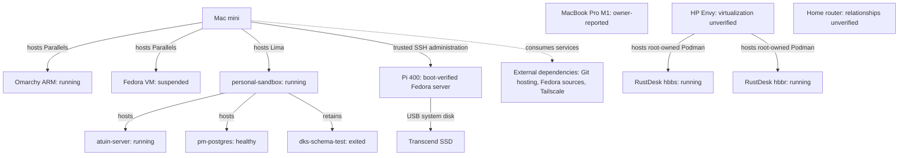
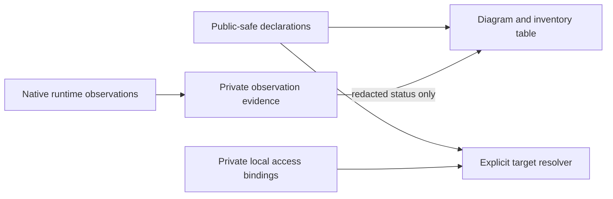
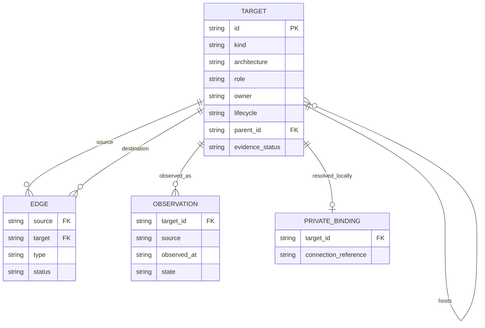

# Homelab topology

## Overview and boundaries

Maintain the operator's personal infrastructure map and declared development
execution targets in dotfiles. Work/cloud environments are external dependencies,
not managed targets. Phones/tablets, workload movement, automatic scheduling and
changes to running resources are non-goals for the first slice. This context owns
identity and relationships; Raspberry Pi bootstrap consumes a declared target ID.
Existing chezmoi and dotfiles-ai contexts retain configuration ownership.
Engineering defaults are in PROFILE.md. Delivery is an elevated-risk read-only CLI and declaration. DBSCTR cycle
HOMELAB-TOPOLOGY-001 owns implementation in an isolated checkout.

## Domain and authoritative data

A Target has a stable logical ID, kind (physical, VM, container, storage or
external dependency), role, architecture, lifecycle intent, configuration owner
and optional hosting parent. AccessBinding maps its ID to private connection
information locally. Observation records source, time, state and uncertainty.
DeclaredTargetChanged and ObservationRecorded are distinct events; observations
cannot silently rewrite declarations. The operator owns all personal declarations.

The versioned inventory is JSON using schema version 1. Each target ID is
unique; hosting edges form an acyclic graph. External dependencies cannot become
admin targets merely by being visible on Tailscale. Unknown fields remain null or
explicitly unknown. Sources are declarations and bounded native runtime queries;
sinks are inventory table, topology diagram and explicit target resolution.

## Inventory and verified updates

Baseline gathered during this session on 2026-10-12. Prior-session facts are
identified separately. Pi and SSD rows include the verified bootstrap update
below. Offline means an observation, not retirement.

| Logical ID | Kind / architecture | Role and hosting | Evidence / limits |
|---|---|---|---|
| mac-mini | physical / ARM64 | administration workstation and guest host | Existing session machine; macOS 27.0.1 observed; M4 Pro / 64GB known from earlier host inspection |
| macbook-pro | physical / ARM64 | portable workstation; no workload assigned | Owner reports M1 / 16GB / 512GB; owner confirms remote identity; Tailscale peer observed offline |
| hp-envy | physical / x86_64 | Omarchy daily-driver workstation | Live owner probe verified x86_64 and roughly 8GB RAM; user-level Podman empty; root-level Podman hosts two RustDesk containers; Docker daemon unavailable |
| pi400 | physical / ARM64 | active headless Fedora server | Fedora 44 USB boot, trusted key-only SSH, expanded root and two fresh reboots verified; Tailscale access persists; no workload assigned |
| pi-system-ssd | storage | external Pi system drive | Transcend 512.1GB flash and full image readback verified; attached to Pi as system disk; root filesystem reports 467.2GiB |
| omarchy-arm | VM / ARM64 | Mac mini Parallels guest, daily-driver trial | Running observed; resource allocation previously verified as 6 CPU / 12GB RAM / 64GB root |
| fedora-vm | VM / unknown until refreshed | Mac mini Parallels guest | Suspended observed; no resource or workload changes |
| personal-sandbox | VM / ARM64 | Mac mini Lima guest, current service host | Fedora 44 Cloud observed; running; 4 CPU / 8GiB RAM / 60GiB disk reported by Lima |
| atuin-server | container / unknown until image metadata checked | personal-sandbox; shell-history service | Running, image pinned by digest; persistent named volume observed; backup policy unverified |
| pm-postgres | container / unknown until image metadata checked | personal-sandbox; existing PostgreSQL service | Running and healthy, image pinned by digest; persistent named volume and two initialization/health bind mounts observed; consumer and backup policy unverified |
| dks-schema-test | container / unknown until image metadata checked | personal-sandbox; existing test container | Exited successfully; retained container is not an active workload |
| rustdesk-hbbs | container / unknown until image metadata checked | hp-envy; existing RustDesk server component | Running, root-owned Podman; pinned image digest |
| rustdesk-hbbr | container / unknown until image metadata checked | hp-envy; existing RustDesk server component | Running, root-owned Podman; pinned image digest |
| home-router | physical / unknown | network infrastructure | Router peer observed on Tailscale; model inferred from peer label, not hardware-verified; LAN relationships unverified |

Docker and Podman command names returned the same container names/images/states.
This is one observed set; Podman reports rootless container storage and crun.
Exact Docker alias configuration remains unverified. Other external storage is known to be attached but mount ownership,
backups and service use need a bounded follow-up inventory. Work sandbox is excluded.

## Behaviors and contracts

- Given a declared target, when inventory is rendered, its ID, role, architecture,
  owner and evidence state appear consistently in diagram and table.
- Given an unreachable target, when observing it, its declaration remains and its
  observation becomes unavailable/stale; it is never deleted automatically.
- Given a work/external peer, when discovering connectivity, it stays outside the
  personal administration target set.
- Given private access bindings, when rendering public artifacts, endpoints,
  remote identities, serials and secrets are omitted.
- Given conflicting, duplicate or cyclic identities, when validating inventory,
  fail before resolving an administration target or launching a mutating action.
- Given no assigned execution workload, target resolution reports unassigned;
  it does not infer a target from architecture, hostname or online state.

CLI: `homelab validate`, `homelab topology`, `homelab targets`,
`homelab inspect TARGET`. Mutation is not an inventory command. Observer outputs
are bounded and redact private fields by default. No broad credential/configuration
scraping is authorized. Physical boot failure requires explicit recovery handling.

## Visual Evidence

Boundary: required deployment diagram. Interaction: not_applicable for this
read-only declaration slice; observer ordering is described above. State: required
transition table below. Data/trust: required boundary diagram below. Schema: required entity diagram below; concrete schema and hosting constraints
are explicit above. Dependency/deployment: required topology. Quantitative:
not_applicable; no performance or capacity claims are inferred from this inventory.

Canonical sources: inventory table and owner declarations; operator owned. Update
visuals and Text Equivalents whenever hosting, scope or trust boundaries change.



**Text Equivalent:** Mac mini hosts Omarchy ARM and suspended Fedora through
Parallels, and running personal-sandbox through Lima. The sandbox hosts running
Atuin and healthy PostgreSQL and retains an exited schema-test container. MacBook
Pro, HP, router and Pi are separate targets; their LAN links are not asserted.
HP hosts running root-owned Podman containers for RustDesk hbbs and hbbr.
Pi administration from Mac mini and SSD system-drive attachment are verified.
Git hosting, Fedora sources and Tailscale are external services, not managed hosts.



**Text Equivalent:** Public declarations feed both diagram/table and target
resolution. Private local bindings feed target resolution only. Native observations
are retained locally; only redacted status reaches public-safe output.

| Observation transition | Guard / effect |
|---|---|
| unknown to observed | Successful bounded probe; record source and time |
| observed to stale | Freshness interval elapsed; retain declaration |
| any to unavailable | Probe or authorization failure; no inferred deletion |
| declaration to retired | Explicit owner decision; separate access/data-retention review |

## Validation, operations and open decisions

Validation covers schema/acyclicity tests, public/private output separation,
unknown/unreachable handling, deterministic diagram/table parity, exact target
resolution, and live read-only comparisons. Existing pytest and chezmoi isolation
are selected authorities. macOS and Omarchy isolated target installs passed;
Mac host installation and CLI validation passed.
HP virtualization inventory, router interfaces and backup/recovery ownership
remain unknown. Stateful mounts in personal-sandbox have been observed. Architecture does not assign workloads.
Observations older than seven days are stale. `inspect TARGET` selects a stable
logical ID exactly; it never launches an administration action. No new public service or spend is authorized.

## Gate Ledger

| Gate | Applicability | Result |
|---|---|---|
| Domain, Behavior, Spec, Contract | required | passed |
| Test | required | passed; 23 scoped tests |
| Refactor, Review/Integrate | required | passed; delivered in PR #33 |
| Release | not_applicable: no packaged/hosted release | not_run |
| Deploy, Operate, Maintain/Retire | required for long-lived managed inventory | passed; installed host verified and recovery documented |

No Gate Exceptions approved. Public source review and private-output omission
tests cover this inventory boundary; there is no private-inventory publication.

## First implementation slice

Deliver `dot_local/bin/executable_homelab` as a Python 3.12+ standard-library CLI
and `private_dot_config/homelab/targets.json` as versioned public-safe declarations.
`validate`, `targets`, `topology`, and `inspect TARGET` are read-only and never
launch a workload or apply configuration. No development workload is reassigned.
A separately selected private local access overlay is excluded from committed
declarations and from default output. Observations keep source/time/status and
never rewrite desired declarations. Unknown backup/network/virtualization facts
remain explicit rather than blocking a truthful first inventory.

Schema v1 includes targets (id, kind, architecture, role, owner, lifecycle,
parent_id, evidence_status, notes) and dependency edges (source, target, type,
status). IDs are unique; required fields/types are checked; hosting is acyclic;
all edge endpoints exist. Connections, serials and authentication fields belong
only in private bindings. Fail before resolving a target on malformed input.
Topology output is deterministic Mermaid with an equivalent target/edge listing.

Validation authorities: configured pytest for schema, references, cycles,
determinism, private-overlay omission and CLI read-only behavior; scoped QA/diff
review for the exact documentation import closure and declared public fields;
chezmoi target isolation for managed artifacts. No new publication denylist or
scanner is introduced. Runtime observation limitations remain explicit.



**Text Equivalent:** Every declaration has a unique target ID. A target may host
multiple targets; each hosted target has at most one hosting parent, and hosting
is acyclic. Dependency edges reference existing source and destination targets.
Observations reference target IDs separately from declarations. Optional private
connection bindings resolve target IDs locally and are never exported publicly.
This informative schema is owned by the inventory contract and changes with it.

## Concrete command and data contract

Install a standard-library Python 3.12+ executable at `~/.local/bin/homelab`
and public-safe declarations at `~/.config/homelab/targets.json`. Global
`--inventory PATH` overrides only the declaration input. Global `--bindings PATH`
explicitly selects a private JSON overlay; it is never loaded implicitly.
`inspect TARGET --private` is the only command allowed to display its selected
binding. No command interprets a binding as code or starts subprocesses.

Schema v1 has exactly `schema_version`, `targets`, `edges`, and `observations`.
Targets have `id`, `kind`, `architecture`, `role`, `owner`, `lifecycle`,
`parent_id`, `evidence_status`, and `notes`. Kinds are physical, vm, container,
storage, external. Lifecycle is active, planned, retained, or retired.
Architecture is arm64, x86_64, or unknown. Evidence is observed,
owner_reported, planned, or unknown. Notes and role are reviewed public prose.
Logical IDs use lowercase letters, numbers and hyphens; no endpoints are IDs.
Edges have `source`, `target`, `type` (depends_on, attached_to, administered_by)
and `status` (observed, declared, planned, unknown). Hosting uses parent_id.
Observations have `target_id`, `source`, `observed_at` (timezone-aware ISO 8601)
and `state` (running, suspended, healthy, exited, offline, unknown, unavailable).
A timestamp is evidence freshness, not a claim that a resource still runs.

Private overlay shape: `{"schema_version": 1, "bindings": {"TARGET":
{"method": "ssh", "endpoint": "PRIVATE", "user": "OWNER"}}}`. Method is
ssh, tailscale_ssh, local, parallels, or lima. Only endpoint, user and method
are accepted; credentials and executable commands have no field. File must be
regular, not a symlink, owned by the current user, and mode 0600 or stricter.
Bindings reference existing targets. Default rendering does not display them;
private inspection requires both an explicit file and `--private`.

`validate` exits 0 with a count, `targets` emits a sorted tab-separated table,
`topology` emits deterministic Mermaid plus an equivalent target and edge table,
and `inspect` emits a public JSON record with hosting, dependencies, latest
observation and freshness. Its workload assignment is always `unassigned` in
this slice. Errors exit 2 with a generic reason, never raw input values. Unknown
fields, duplicate JSON keys, unknown references, duplicate IDs, self/cyclic
hosting, malformed timestamps and incompatible schemas fail before rendering.
JSON files are bounded to 1 MiB. Mermaid labels are escaped; IDs are generated
from sorted node indexes rather than injected from prose.

## Delivery, operations and recovery

The operator applies only the two inventory artifacts using chezmoi with this
reviewed checkout as source. Omarchy's restrictive allowlist must include them;
other profile behavior is unchanged. Tests render both macOS and Omarchy
profiles in isolated directories. No whole-home apply or existing VM change.

Run `homelab validate` after declaration edits; inspect timestamps before an
administration decision. Refresh observations through explicit reviewed probes;
this slice does not install an automatic collector. Older-than-seven-day and
unavailable observations remain visible without deleting declarations. Restore
these two managed files from a reviewed previous Git revision to roll back.
Private bindings are locally backed up separately; a compromised endpoint or
identity requires operator review and key/access revocation. Retiring a target
requires explicit data retention and access decisions outside this CLI.

Python runtime support follows the repository's >=3.12 requirement. No runtime
third-party dependencies, listening sockets, extra services or paid resources.
Review runtime security updates and upstream changes during routine dotfiles
maintenance. Inventory recovery does not imply service-data backup: Atuin and
PostgreSQL backup policy remains unverified and is an explicit follow-up.

### Administration Mac launch and update

The installed CLI validated 17 targets and five dependency edges. Launch with
`~/.local/bin/homelab targets`, `~/.local/bin/homelab inspect pi400`, or
`~/.local/bin/homelab topology`. It creates no network listeners or background
jobs. The first slice shipped without a populated private endpoint overlay.
Pi bootstrap subsequently installed an owner-only local binding and trusted
known-hosts file; neither belongs in Git or default public output.

After reviewing a source update, apply only these artifacts:

```sh
chezmoi --source /path/to/reviewed/dotfiles apply --parent-dirs --exclude scripts \
  ~/.local/bin/homelab ~/.config/homelab/targets.json
~/.local/bin/homelab validate
```

Use a reviewed prior checkout as `--source` for rollback. Do not reset the primary
checkout or overwrite unrelated local changes. Public declarations are source;
private bindings are local runtime state and must never be added with chezmoi.
The primary source checkout's unrelated local changes remain untouched. Merged
PR #33 is the inventory source authority; Pi bootstrap updates are delivered
separately in PR #36.

## Pi bootstrap observation update — 2026-10-12

The owner-approved Pi deployment is active. USB boot, expanded SSD root,
receipt-bound SSH identity and fresh reboot were verified. Tailscale enrollment
and a further reboot verified MagicDNS key-based SSH access. The versioned
inventory records the active Pi/SSD and observed attachment/administration edges;
no workloads were assigned or moved. Private endpoint bindings and host keys
stay in local owner-only files. Router IPv6 internet works; IPv4 DHCP lease
exhaustion remains unresolved. The owner supplied a Huawei HG8245H interface
view; this does not establish that it is the previously observed Tailscale router
peer. Router peer identity and extender/client inventory need separate discovery.
