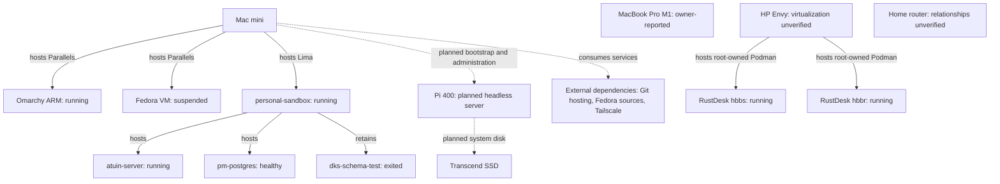
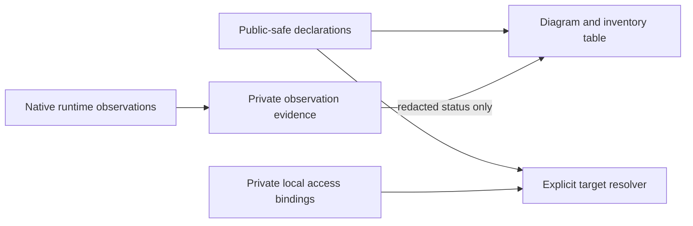
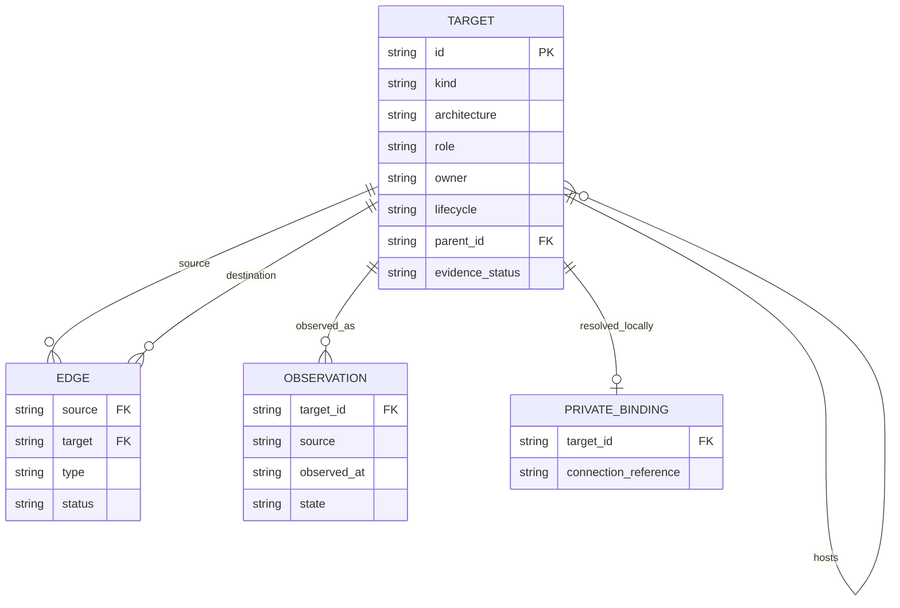

# Homelab topology

## Overview and boundaries

Maintain the operator's personal infrastructure map and declared development
execution targets in dotfiles. Work/cloud environments are external dependencies,
not managed targets. Phones/tablets, workload movement, automatic scheduling and
changes to running resources are non-goals for the first slice. This context owns
identity and relationships; Raspberry Pi bootstrap consumes a declared target ID.
Existing chezmoi and dotfiles-ai contexts retain configuration ownership.
Engineering defaults are in PROFILE.md. Current delivery is local Discovery only;
future inventory delivery is elevated risk. No implementation cycle is registered.

## Domain and authoritative data

A Target has a stable logical ID, kind (physical, VM, container, storage or
external dependency), role, architecture, lifecycle intent, configuration owner
and optional hosting parent. AccessBinding maps its ID to private connection
information locally. Observation records source, time, state and uncertainty.
DeclaredTargetChanged and ObservationRecorded are distinct events; observations
cannot silently rewrite declarations. The operator owns all personal declarations.

The future versioned inventory is JSON using schema version 1. Each target ID is
unique; hosting edges form an acyclic graph. External dependencies cannot become
admin targets merely by being visible on Tailscale. Unknown fields remain null or
explicitly unknown. Sources are declarations and bounded native runtime queries;
sinks are inventory table, topology diagram and explicit target resolution.

## Baseline inventory

Baseline gathered during this session on 2026-10-12. Prior-session facts are
identified separately. Offline means an observation, not retirement.

| Logical ID | Kind / architecture | Role and hosting | Evidence / limits |
|---|---|---|---|
| mac-mini | physical / ARM64 | administration workstation and guest host | Existing session machine; macOS 27.0.1 observed; M4 Pro / 64GB known from earlier host inspection |
| macbook-pro | physical / ARM64 | portable workstation; no workload assigned | Owner reports M1 / 16GB / 512GB; owner confirms remote identity; Tailscale peer observed offline |
| hp-envy | physical / x86_64 | Omarchy daily-driver workstation | Live owner probe verified x86_64 and roughly 8GB RAM; user-level Podman empty; root-level Podman hosts two RustDesk containers; Docker daemon unavailable |
| pi400 | physical / ARM64 | planned headless Fedora server | Owner reports Pi 400; boot/SSH not verified; no workload assigned |
| pi-system-ssd | storage | external Pi system drive | Transcend 512.1GB observed attached to administration Mac; permanent Pi attachment is planned |
| omarchy-arm | VM / ARM64 | Mac mini Parallels guest, daily-driver trial | Running observed; resource allocation previously verified as 6 CPU / 12GB RAM / 64GB root |
| fedora-vm | VM / unknown until refreshed | Mac mini Parallels guest | Suspended observed; no resource or workload changes |
| personal-sandbox | VM / ARM64 | Mac mini Lima guest, current service host | Fedora 44 Cloud observed; running; 4 CPU / 8GiB RAM / 60GiB disk reported by Lima |
| atuin-server | container / unknown until image metadata checked | personal-sandbox; shell-history service | Running, image pinned by digest; persistent named volume observed; backup policy unverified |
| pm-postgres | container / unknown until image metadata checked | personal-sandbox; existing PostgreSQL service | Running and healthy, image pinned by digest; persistent named volume and two initialization/health bind mounts observed; consumer and backup policy unverified |
| dks-schema-test | container / unknown until image metadata checked | personal-sandbox; existing test container | Exited successfully; retained container is not an active workload |
| rustdesk-hbbs | container / unknown until image metadata checked | hp-envy; existing RustDesk server component | Running, root-owned Podman; pinned image digest |
| rustdesk-hbbr | container / unknown until image metadata checked | hp-envy; existing RustDesk server component | Running, root-owned Podman; pinned image digest |
| home-router | physical / unknown | network infrastructure | Router peer observed on Tailscale; model inferred from peer label, not hardware-verified; LAN relationships unverified |

Docker and Podman command names returned the same container names/images/states.
This is one observed set; Podman reports rootless container storage and crun.
Exact Docker alias configuration remains unverified. Other external storage is known to be attached but mount ownership,
backups and service use need a bounded follow-up inventory. Work sandbox is excluded.

## Behaviors and contracts

- Given a declared target, when inventory is rendered, its ID, role, architecture,
  owner and evidence state appear consistently in diagram and table.
- Given an unreachable target, when observing it, its declaration remains and its
  observation becomes unavailable/stale; it is never deleted automatically.
- Given a work/external peer, when discovering connectivity, it stays outside the
  personal administration target set.
- Given private access bindings, when rendering public artifacts, endpoints,
  remote identities, serials and secrets are omitted.
- Given conflicting, duplicate or cyclic identities, when validating inventory,
  fail before resolving an administration target or launching a mutating action.
- Given no assigned execution workload, target resolution reports unassigned;
  it does not infer a target from architecture, hostname or online state.

Proposed CLI: `homelab validate`, `homelab topology`, `homelab targets`,
`homelab inspect TARGET`. Mutation is not an inventory command. Observer outputs
are bounded and redact private fields by default. No broad credential/configuration
scraping is authorized. Physical boot failure requires explicit recovery handling.

## Visual Evidence

Boundary: required deployment diagram. Interaction: not_applicable for this
read-only declaration slice; observer ordering is described above. State: required
transition table below. Data/trust: required boundary diagram below. Schema: required entity diagram below; concrete schema and hosting constraints
are explicit above. Dependency/deployment: required topology. Quantitative:
not_applicable; no performance or capacity claims are inferred from this inventory.

Canonical sources: baseline table and owner declarations; operator owned. Update
visuals and Text Equivalents whenever hosting, scope or trust boundaries change.

**Text Equivalent:** Mac mini hosts Omarchy ARM and suspended Fedora through
Parallels, and running personal-sandbox through Lima. The sandbox hosts running
Atuin and healthy PostgreSQL and retains an exited schema-test container. MacBook
Pro, HP, router and Pi are separate targets; their LAN links are not asserted.
HP hosts running root-owned Podman containers for RustDesk hbbs and hbbr.
Pi administration from Mac mini and SSD system-drive attachment are planned.
Git hosting, Fedora sources and Tailscale are external services, not managed hosts.

**Text Equivalent:** Public declarations feed both diagram/table and target
resolution. Private local bindings feed target resolution only. Native observations
are retained locally; only redacted status reaches public-safe output.

| Observation transition | Guard / effect |
|---|---|
| unknown to observed | Successful bounded probe; record source and time |
| observed to stale | Freshness interval elapsed; retain declaration |
| any to unavailable | Probe or authorization failure; no inferred deletion |
| declaration to retired | Explicit owner decision; separate access/data-retention review |

## Validation, operations and open decisions

Required evidence: schema/acyclicity tests, public/private output separation,
unknown/unreachable handling, deterministic diagram/table parity, exact target
resolution, and live read-only comparisons. Existing pytest and chezmoi isolation
are selected authorities; no deployment tests have run for new tooling.
HP virtualization inventory, router interfaces and backup/recovery ownership
remain unknown. Stateful mounts in personal-sandbox have been observed. Architecture does not assign workloads.
A refresh interval and operational target-selection interface will be finalized
before implementation. No new public service or spend is authorized.

## Gate Ledger

| Gate | Applicability | Result |
|---|---|---|
| Domain, Behavior, Spec, Contract | required | pending; Discovery draft only |
| Test, Refactor, Review/Integrate | required | not_run |
| Release | not_applicable: no packaged/hosted release | not_run |
| Deploy, Operate, Maintain/Retire | required for long-lived managed inventory | not_run |

No Gate Exceptions approved. Publication authority for private infrastructure
metadata is a capability gap; candidate artifacts use public-safe logical data.

## First implementation slice

Deliver `dot_local/bin/executable_homelab` as a Python 3.12+ standard-library CLI
and `private_dot_config/homelab/targets.json` as versioned public-safe declarations.
`validate`, `targets`, `topology`, and `inspect TARGET` are read-only and never
launch a workload or apply configuration. No development workload is reassigned.
A separately selected private local access overlay is excluded from committed
declarations and from default output. Observations keep source/time/status and
never rewrite desired declarations. Unknown backup/network/virtualization facts
remain explicit rather than blocking a truthful first inventory.

Schema v1 includes targets (id, kind, architecture, role, owner, lifecycle,
parent_id, evidence_status, notes) and dependency edges (source, target, type,
status). IDs are unique; required fields/types are checked; hosting is acyclic;
all edge endpoints exist. Connections, serials and authentication fields belong
only in private bindings. Fail before resolving a target on malformed input.
Topology output is deterministic Mermaid with an equivalent target/edge listing.

Validation authorities: configured pytest for schema, references, cycles,
determinism, private-overlay omission and CLI read-only behavior; scoped QA/diff
review for the exact documentation import closure and declared public fields;
chezmoi target isolation for managed artifacts. No new publication denylist or
scanner is introduced. Runtime observation limitations remain explicit.

**Text Equivalent:** Every declaration has a unique target ID. A target may host
multiple targets; each hosted target has at most one hosting parent, and hosting
is acyclic. Dependency edges reference existing source and destination targets.
Observations reference target IDs separately from declarations. Optional private
connection bindings resolve target IDs locally and are never exported publicly.
This informative schema is owned by the inventory contract and changes with it.
