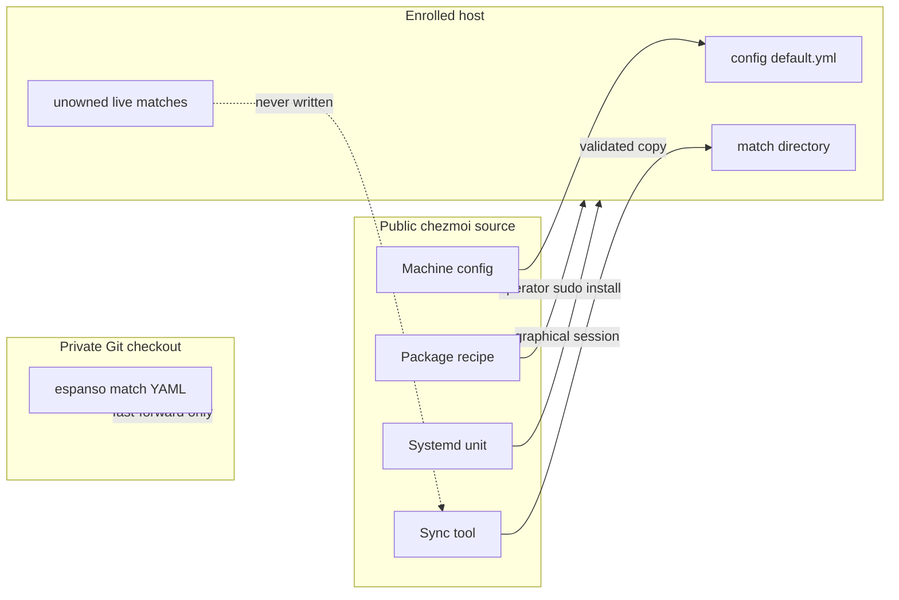
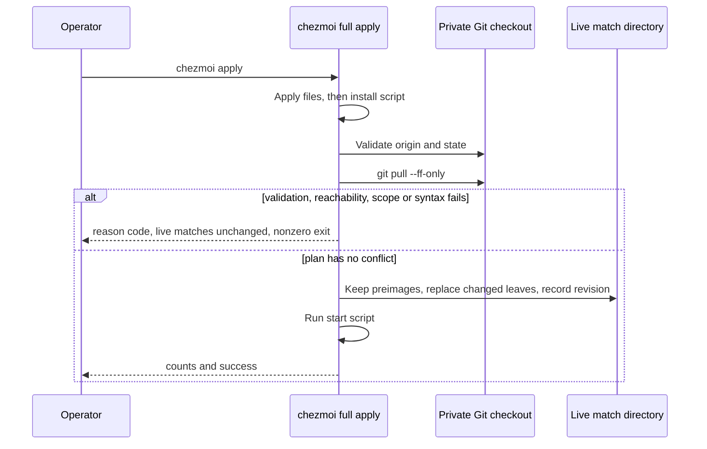

# Espanso machine configuration

Extension to the [host maintenance profile](../PROFILE.md): explicitly include the ARM64 Wayland guest, macOS Mac mini, ARM64 MBP Omarchy and x86-64 HP Omarchy. The [initiative](../../../initiatives/espanso-distribution/README.md) owns ordering and gates.

Public chezmoi owns reviewed `config/` settings beneath the platform Espanso config root, install declarations and login startup. Private Git owns only `match/`. Public Git and chezmoi ignore rules must protect match trees on both platforms while allowing only intended machine settings. Never feed generated guest defaults back into private Git. Replace the legacy helper's combined `add` behavior before enrolling an existing installation.

Use a checksum-pinned native Wayland source package for the ARM64 guest; the HP helper's AMD64 Debian payload cannot serve it. Build unprivileged and verify packaged input permissions rather than running the daemon as root. Use one graphical user service on Linux. Preserve the guest's Finnish layout, the MBP's custom keymap and the HP's working settings; preserve the Mac app and startup during adoption.

## Apply contract and acceptance

| Given | When | Expected |
|---|---|---|
| No explicit local enrollment | Public apply | Public configuration works without contacting private Git. |
| Enrolled host with clean tracked checkout | Normal full apply | Validate the configured origin and disjoint leaf ownership, fast-forward only, validate incoming match scope, then apply matches once. No auto-push. |
| Targeted apply, diff or dry run | Preview or single-file operation | No private network or synchronization side effects. Integration must not recurse or double-run the Mac's existing apply workflow. |
| Offline, unknown origin, conflicting edits, divergent history, overlapping ownership or invalid YAML | Sync requested | Report incomplete sync without values; preserve local work and last working matches. No force, reset or automatic merge. |
| Fresh VM with both host and guest expanders available | Type a guest-only test trigger directly in the VM window | One guest expansion. Also verify one shared match, login startup, unchanged repeat apply and offline behavior. Remote-control keyboard paths are outside this acceptance gate. |

Use synthetic fixtures for profile rendering, ignored/private paths and sync failure tests; extend `tests/test_omarchy_try_profile.py` and run the configured pytest suite. Compare rendered leaf owners before and after update. Preview on each host and retain restricted preimages. Roll back only owned changes after checking for newer edits; disabling enrollment stops sync without deleting matches.

## Domain

Owner: dotfiles maintainer. Modules: Shell (changed scripts), Python (one stdlib-only
executable and its tests), Security (confidential text, executable match variables,
input-device access, two writers). No new runtime dependency, package, public service
or product UI is introduced.

- **Ubiquitous language.** A *machine profile* is one of ARM64 `omarchy-try`, x86-64
  HP or ARM64 `mbp-omarchy` under `omarchy` (excluding `old-omarchy`), and darwin
  `mac-mini`. The *config root* is `~/.config/espanso` on Linux and
  `~/Library/Application Support/espanso` on macOS. *Public leaves* are the machine
  settings chezmoi manages; *match leaves* are the top-level YAML files directly
  under the config root's `match/`. *Enrollment* is the machine-local declaration of
  a private checkout; *deployed* leaves were last written by a sync, *unowned* live
  leaves were not (the operator's own matches or Espanso's generated sample).
- **Entities and values.** Reviewed package (pinned source archive and checksum),
  machine settings, private checkout revision, deployed-leaf record, restricted
  preimage, failure reason code.
- **Owners.** Public Git owns the package recipe, `config/default.yml`, the systemd
  unit and its enablement, and the sync tool. `dotfiles-private` owns reviewed
  `espanso/match/*.yml`; this repository never imports it. The operator owns
  enablement, enrollment, the sudo package step and typed acceptance.
- **Sources and sinks.** Sources: this repository, the enrolled private checkout at
  a commit, the Arch toolchain. Sinks: `/usr/bin/espanso`, the config root, the user
  systemd manager, `~/.local/state/espanso-match-sync`.
- **Trust boundaries.** (1) Private Git to host: match YAML may carry shell
  variables that run with the user's privileges, so origin identity, scope and
  syntax are validated before any live leaf changes. (2) Public Git to host: the
  build recipe and archive checksum are reviewed here. (3) Host to kernel input:
  the package grants `cap_dac_override+p` on the binary only, which is Espanso's
  supported unprivileged Wayland model; the daemon never runs as root and child
  processes do not inherit the capability. (4) chezmoi to scripts: root run scripts
  execute only in an unqualified full apply.
- **Affected artifacts.** `.chezmoiignore`, `.gitignore`, `.chezmoi.toml.tmpl`,
  `config.omarchy-try.example.toml`, `private_dot_config/espanso/`,
  `private_Library/Application Support/espanso/`, the Espanso systemd unit and
  enablement, `dot_local/lib/omarchy-apps/recipes/espanso-wayland/`, the guest
  recipe manifest and its install hook, `run_onchange_after_start-espanso.sh.tmpl`,
  `run_after_load-espanso-matches.sh.tmpl`, `dot_local/bin/executable_espanso-match-sync`,
  `dot_local/bin/executable_omarchy-espanso-setup`, their tests, README,
  `docs/OMARCHY_TRY.md` and the HP next-steps document.

## Behavior

Given/When/Then in Domain terms; the apply contract above remains the authority.

1. Given a machine profile without `espanso_enabled`, when any chezmoi operation
   runs, then no Espanso target, recipe or script is rendered and nothing changes.
2. Given `espanso_enabled`, when a full apply runs, then the guest recipe declares
   the pinned native package, the reviewed machine settings, one graphical user
   unit and its enablement are applied, and the service starts once the binary and
   its packaged capability exist in an active graphical session.
3. Given the binary or its `cap_dac_override+p` capability is missing, when the
   start script runs, then it reports the condition and does not start the daemon.
4. Given enrollment on a host with a clean tracked checkout whose origin matches
   the configured identity, when a full apply finishes its files, then the sync
   checks disjoint ownership, fast-forwards, validates scope and syntax, replaces
   only changed match leaves, records the revision and reports counts.
5. Given a second full apply with no new upstream commit, when the sync runs, then
   live leaves are byte- and mtime-identical.
6. Given an upstream removal of a deployed leaf unchanged since deployment, when
   the sync runs, then that leaf is removed after a restricted preimage is kept.
7. Given a live leaf the sync did not deploy, when the sync runs, then it is
   modified or removed only when its name arrives from private Git with byte-identical
   content, in which case it is adopted without being rewritten.
8. Given a failed validation, when the sync stops, then no live leaf has changed,
   the private checkout is at most fast-forwarded, nothing is pushed and output
   carries a reason code plus leaf names only.
9. Given a targeted apply, `diff`, `status`, `--dry-run` or an unenrolled host,
   when chezmoi runs, then the sync is not executed and no private network or
   synchronization side effect occurs. The sync never invokes `chezmoi apply`.
10. Given enrollment is removed, when a full apply runs, then the sync tool leaves
    with the managed targets and every live match stays.
11. Given the helper runs on an x86-64 Omarchy host, when installation finishes,
    then it verifies the packaged capability and stops: it writes no config, creates
    no local private source and registers no service.

## Interfaces

| Interface | Owner | Behavior |
|---|---|---|
| chezmoi data `espanso_enabled` (boolean, absent = false) | operator, machine-local | 1, 2, 10 |
| chezmoi data `espanso_private_checkout` and `espanso_private_origin` (non-empty strings; both present = enrolled) | operator, machine-local | 4–10 |
| `private_dot_config/espanso/config/default.yml.tmpl` | public Git | 2 |
| `private_Library/Application Support/espanso/config/default.yml` (byte-identical to the Mac's stock 2.1.8 file, SHA-256 `cf8f40f250c263655a008b004f2c37d0f937a607bcac2500b888dee64de17a0e`) | public Git | 2 |
| `private_dot_config/systemd/user/espanso.service`, `.../graphical-session.target.wants/symlink_espanso.service` | public Git | 2 |
| `dot_local/lib/omarchy-apps/recipes/espanso-wayland/{PKGBUILD,espanso-wayland.install}` and the arm64 guest manifest entry | public Git | 2 |
| `run_onchange_after_start-espanso.sh.tmpl` (target `start-espanso.sh`) | public Git | 2, 3 |
| `run_after_load-espanso-matches.sh.tmpl` (target `load-espanso-matches.sh`) | public Git | 4–10 |
| `espanso-match-sync --checkout DIR --origin URL [--config-root DIR] [--state-dir DIR]` | public Git | 4–10 |
| `omarchy-espanso-setup` | public Git | 11 |
| `.chezmoiignore`, `.gitignore` | public Git | 1, 7 |

Machine settings. The guest sets `keyboard_layout.layout: fi`. HP and MBP set
`layout: us`, `variant: colemak_dh_ortho` and `toggle_key: OFF`: the text the
legacy helper generated for a fresh HP install and the base of the MBP `tis.xkb`
keymap. The HP's live file and MBP expansion are compared and verified at their own
rollout steps. The Mac file changes nothing.

Guest package. A reviewed copy of AUR `espanso-wayland` (commit `5e7d5a67`) raised
to v2.4.1, `arch=(aarch64)`, source archive pinned by SHA-256
`3121627138be4b1f106b8dfd73fb4b7030ecb44c6a8f4e7628a1174b58e5cfe2`, built with
`cargo build --frozen --release --features wayland` by unprivileged `makepkg`. Its
hook sets `cap_dac_override+p` on `/usr/bin/espanso`. It installs no unit: chezmoi's
graphical-session unit is the only service definition. v2.4.1 follows the HP's
`espanso-wayland-bin` 2.4.1 package line; upstream publishes no ARM64 Linux build.
The build is qualified on the guest during Deploy.

Script ordering. chezmoi runs same-phase scripts by target name, so
`install-omarchy-apps` < `load-espanso-matches` < `start-espanso`: the first daemon
start sees deployed matches instead of generating the default sample.

Sync sequence. Lock one sync per state directory; validate the checkout (real
repository root, attached branch, upstream, normalized origin equality with the
configured identity, no tracked modifications, no interrupted operation); refuse
when any public managed leaf is the match directory or below it; `git pull
--ff-only`; read the incoming `espanso/match` tree; plan; apply; record.

Match scope. Only top-level blobs with mode `100644`, names matching
`[A-Za-z0-9][A-Za-z0-9._-]*\.ya?ml` and size at most 1 MiB are deployable. Any other
entry under `espanso/match` — subdirectory, script, executable or symlink — fails
the whole sync. Other private paths are never deployed.

State. `~/.local/state/espanso-match-sync/` (mode `0700`) holds `state.json`
(`revision`, deployed leaf names), `lock`, and `preimages/<UTC timestamp>/` copies
(mode `0600`) of every replaced or removed live leaf.

Reason codes. `checkout-unavailable`, `detached-head`, `no-upstream`,
`unknown-origin`, `dirty-checkout`, `in-progress-operation`, `public-overlap`,
`unreachable`, `diverged`, `invalid-scope`, `invalid-yaml`, `local-edit`,
`unowned-collision`, `non-regular-live-file`, `write-failed`, `busy`,
`chezmoi-unavailable`. Exit `0` for a complete sync, `1` for an incomplete one.

## Contract

- **Preconditions.** The sync runs as the desktop owner with `git` and the chezmoi
  executable that ran the apply (`CHEZMOI_EXECUTABLE`, else `PATH`). Enrollment
  values come only from machine-local chezmoi data.
- **Postconditions.** Every deployed leaf equals the private blob at the recorded
  revision; unowned leaves are untouched except byte-identical adoption; the
  private checkout has no new local commit, stash, reset or merge.
- **Invariants.** Only regular files directly in `match/` are written, with mode
  `0600` through same-directory temporary files and atomic rename; symlinks are
  never followed or replaced; no live leaf changes unless the whole plan passed;
  YAML is parsed with chezmoi's embedded parser before replacement and chezmoi's
  error text, which quotes file content, is discarded.
- **Failure semantics.** Any reason code leaves live matches as they were. A write
  error after the first replacement restores all preimages before reporting
  `write-failed`. An unreachable origin therefore fails the outer apply visibly.
- **Compatibility and rollback.** The HP keeps its `espanso-wayland-bin` package,
  unit and live files until `espanso_enabled` is set; a preview with `chezmoi diff`
  follows enablement and precedes apply. Turning enablement off removes the public
  config, unit and enablement on the next apply but not the package or matches.
  Restore a preimage only after confirming no newer edit depends on the live file.
- **Security and reliability.** Git runs with prompts disabled; origin URLs are
  never printed. The recipe builds as the user and reaches root only through the
  operator's `pacman -U`. Concurrency is bounded by the state lock. No log value,
  trigger or replacement is emitted.
- **Stale artifacts and validation.** `uv run --group test pytest tests/` is the
  configured authority; `bash -n` covers rendered scripts; `makepkg --verifysource`
  checks the pinned archive; `chezmoi diff` previews each host before apply.
  Residual risk: the YAML pre-check is not Espanso's own schema parser, and the
  `cap_dac_override` capability widens file access for the Espanso process itself.

## Gate ledger

| Gate | Applicability | Result | Authority |
|---|---|---|---|
| Domain | required | pending | Spec tests on this document |
| Behavior | required | pending | Spec tests on this document |
| Spec | required | pending | Spec tests on this document |
| Contract | required | pending | Rendered-profile and fake-command tests |
| Test-driven implementation | required | pending | Failing-first pytest fixtures |
| Refactor | required | pending | Full pytest suite, `git diff --check` |
| Review/Integrate | required | pending | Scoped QA and diff coherence |
| Release | not applicable: no published artifact | not_run | Engineering Profile |
| Deploy | required | pending | Guest apply with operator sudo step |
| Operate | required | pending | Service health and typed guest expansion |
| Maintain/Retire | required | pending | Removal, preimage and disable tests |

No gate exception is requested.

## Visual Evidence

| Concern | Decision | Review question | Canonical source | Owner/change trigger |
|---|---|---|---|---|
| Boundary | required: ownership flowchart | Which writer owns which leaf? | Domain | New writer or leaf class |
| Interaction | required: sequence diagram | What may change before a failure stops the sync? | Interfaces, Failure semantics | Sync order change |
| State | required: transition table | Which live-leaf states may be replaced? | Behavior 6–8 | New conflict rule |
| Data/trust | required: directional flow | Where does confidential text or privilege cross? | Trust boundaries | New trust boundary |
| Schema | not applicable: two-field state file is stated inline | - | Interfaces | New persisted field |
| Dependency/deployment | required: covered by the sequence diagram's apply phase order | Why must install precede load precede start? | Script ordering | Script rename |
| Quantitative | not applicable: correctness uses set and byte equality | - | Contract | Metric-controlled decision |

| Stage | Input → output | Gate to proceed |
|---|---|---|
| Adoption | Mac live matches → private Git | Recoverable preimage and exact-candidate private review |
| Guest | Public machine settings + private matches → VM | Expansion in the VM window, repeat apply and offline preservation |
| Fleet | Same matches + each host's settings → remaining hosts | Verify local input and rollback on each host before advancing |

| Live leaf before sync | Arrives from private Git | Result |
|---|---|---|
| absent | yes | add after syntax and scope validation |
| deployed, equal to recorded revision | yes | replace when content differs; otherwise unchanged |
| deployed, different from recorded revision | yes | `local-edit`, nothing changes |
| unowned, byte-identical | yes | adopt without rewriting |
| unowned, different or not a regular file | yes | `unowned-collision` or `non-regular-live-file`, nothing changes |
| any | no | deployed and unchanged: remove after preimage; otherwise untouched |

**Text Equivalent:** Public chezmoi owns the package recipe, machine config, the
systemd unit and the sync tool. Private Git owns match YAML. On an enrolled host the
sync copies validated match leaves into the live match directory; unowned live
matches are never written. Owner: dotfiles maintainer; update when a writer or leaf
class is added.

**Text Equivalent:** A full chezmoi apply applies files, then runs the install,
load and start scripts in name order. The load script validates the private
checkout, fast-forwards it, and replaces live match leaves only when the whole plan
passes. Any failure leaves live matches unchanged, fails the apply visibly and
pushes nothing. Targeted applies, diff, status and dry runs execute none of it.
Owner: dotfiles maintainer; update when the sync order changes.
