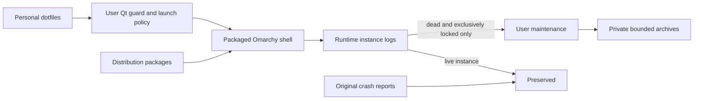

# Omarchy shell reliability

## Scope and Engineering Profile overrides

OMARCHY-SHELL-001 explicitly includes the personal `omarchy` profile on Linux
x86_64, extending the context's default macOS scope for this feature only. The
operator owns deployment. Other machine profiles, the ARM workstation, shared
`dotfiles-ai`, Worktrunk, and packaged Qt/Quickshell files are unchanged.

The deliverable is a chezmoi-managed user extension, launcher and maintenance
timer. Applicable modules are Shell, Python and Cloud/host operations; native
extension code uses C++17 and public Qt 6 Core, Gui, Qml and Quick APIs. Python
requires the repository's existing >=3.12 runtime and stdlib. The qualified live
combination is Omarchy 4.5, Quickshell 0.3.2 and Qt 6.12 on Linux x86_64.

Risk is elevated: the extension executes in the daily desktop shell and cleanup
removes expired diagnostic files. Delivery is a draft source PR and targeted HP
deployment. Release is not applicable; all kernel, Review/Integrate, Deploy,
Operate and Maintain/Retire gates are required. No gate exception is assumed.

## Domain and ownership

- **ContextMenuGuard**: a service-owned Qt application event filter. It consumes
  only a ContextMenu event delivered to a QQuickWindow with a null local position
  and no active focus item. All other events retain their normal delivery.
- **GuardModule**: a user-built QML extension, identified by its source and Qt
  build inputs. It belongs to this source, not the distribution package manager.
- **OmarchyLaunch**: the packaged shell configuration launched through the
  ordinary `quickshell` command. Administrative commands are not launches.
- **DeadInstance**: a native instance reported for the packaged Omarchy config
  whose `instance.lock` can be exclusively locked with native POSIX locking.
- **ManagedArchive**: a private copy of a dead instance's regular log files in
  the feature's own state directory. Existing crash reports are not managed
  archives and are never pruned by this feature.

This addresses the Qt context-menu null-focus defect described in
[Omarchy #6805](https://github.com/omacom/omarchy/issues/6805) and the proposed
[upstream guard](https://github.com/quickshell-mirror/quickshell/pull/1325).
Until the packaged upstream fix is qualified, this is a persistent runtime guard;
it does not claim to change Qt itself or resolve unrelated native crashes.

## Behavior

| Given | When | Required result |
|---|---|---|
| A focusless Quick window and origin context-menu event | Qt dispatches it | The guard consumes the unsafe event without a crash |
| A focused window, non-origin event, or another QObject | An event arrives | Normal event delivery continues |
| The native user plugin is enabled | Its service is created | The actual native filter becomes active and reports activation |
| A packaged Omarchy shell launch | The managed launcher runs | Native sparse capture is selected; inherited import paths and argv survive |
| A Quickshell CLI operation or another configuration | The launcher runs | Native argv and environment are passed through unchanged |
| A live instance, unsafe path, malformed inventory, or unavailable lock | Maintenance runs | Its runtime files are not removed |
| An owned dead instance with regular logs | Maintenance runs | Files are archived outside runtime storage before their runtime copies are removed |
| Private archives exceed retention | Maintenance runs | Only this feature's old archives are pruned within the declared policy |
| Another profile renders | Chezmoi computes targets | No guard, wrapper or timer is introduced |
| A later targeted apply | Source and build inputs are unchanged | No rebuild, duplicate plugin, or unrelated preference replacement occurs |

## Interfaces and contracts

The managed `~/.local/bin/quickshell` delegates to `/usr/bin/quickshell`. Only
launches of `/usr/share/omarchy/shell` (or its `shell.qml`) receive
`--no-detailed-logs` and the user module import directory. CLI operations,
argument boundaries, inherited environment and native exit/signal behavior are
preserved. No `LD_PRELOAD`, systemwide Qt patching or runtime-directory relocation
is used.

Native plugin `dotfiles.context-menu-guard` uses the existing user-plugin manifest
and a `keepLoaded` service importing `Dotfiles.ContextMenuGuard 1.0`. Its QObject
owns the global filter; destroying the service removes the filter. Build the
module with existing `c++`, `pkg-config` and Qt `moc`, stage it privately and
publish atomically only after a successful build. Missing tools leave a healthy
installed module untouched and fail before activation. Cache identity includes
source content and the selected Qt build version.
Complete immutable generations are activated through one atomic relative link;
previous generations remain available for rollback. Unknown module targets are
refused rather than adopted.

The baseline managed `shell.json` includes the plugin. Live activation uses
Omarchy's native plugin rescan/enable interface to preserve other preferences.
Source installation and plugin enablement alone are insufficient: acceptance
requires evidence that the native filter actually loaded.

`omarchy-shell-maintenance prune` reads native instance inventory, validates the
canonical runtime root, owner, instance identifier and regular single-link files,
and holds the native exclusive POSIX instance lock while copying and reclaiming
logs. It refuses symlinks and does not truncate any file. It rechecks file
identity and completes private, verified archive writes before unlinking the
matching dead runtime copy. A copy failure retains the source. Runtime cleanup
never follows paths supplied by inventory outside the validated instance root.

Archive ownership is restricted to `~/.local/state/omarchy-shell/log-archives`.
Retain at most eight instance archives, seven days and 64 MiB in total; prune
oldest archives first and expired archives regardless of count. Archive files
are mode 0600 and directories 0700. Files outside this directory, especially
Quickshell's existing crash-report cache, remain outside retention ownership.
A maintenance lock serializes timer and manual runs. A new archive larger than
the whole archive budget can be pruned immediately after its verified runtime
copy is reclaimed; retention limits take precedence over retaining that archive.

A user timer runs maintenance after startup and every fifteen minutes. Native
sparse capture removes the observed internal NetworkManager debug flood. This
policy bounds retained dead archives and reclaims dead runtime logs; it does not
claim an absolute byte cap on a still-live warning stream. Live logs are always
protected, even under storage pressure. A new warning flood is an operating
incident requiring its own diagnosis, not permission to truncate or kill a shell.

## Validation and lifecycle

Authorities are the existing pytest suite, affected rendered-shell syntax checks,
native chezmoi profile inventories, and an isolated Linux Qt regression harness.
No Python type checker or additional test framework is configured for this
repository; preserve its selected authorities. Tests use synthetic data and
isolated homes. Native crash canaries disable core generation.

The Qt harness must demonstrate the unguarded fault, guarded survival, and
forwarding of focused, non-origin and non-window cases. It must load the actual
QML extension, rather than testing a duplicate predicate. Retention tests cover
live POSIX locks, awkward paths, malformed inventory, symlinks, copy failure,
identity changes, private modes, count/age/byte limits and unrelated crash data.
Profile tests cover both eligible and excluded roles and launcher pass-through.

Before deployment, preserve affected live files and native plugin preferences,
preview only this feature's targets, and keep the dirty source checkout intact.
Qualify the module and run maintenance against disposable data first. Enable the
native plugin, then perform one controlled native refresh through the managed
launcher so the new process receives both the import path and sparse capture.
Verify actual filter activation after that refresh; missing activation fails
deployment and triggers recovery. Verify the normal shell, plugin state, timer,
log output and runtime capacity; preserve original crash evidence. Rollback
disables only this
plugin, restores preimages after checking for newer edits, removes only the
feature's timer/launcher/module, and restarts through the native shell owner.

Maintain the guard against the pinned upstream defect and requalify on Qt or
Quickshell changes. Retire it only after a packaged upstream fix passes the same
regression. Removing the feature does not delete retained crash evidence.

Operating checks use native instance inventory and the service's result:

```sh
/usr/bin/quickshell list --all --json
OMARCHY_PATH=/usr/share/omarchy /usr/bin/omarchy-shell shell listPlugins
systemctl --user status omarchy-shell-log-maintenance.timer
journalctl --user -u omarchy-shell-log-maintenance.service
```

For the active instance, verify `OMARCHY_CONTEXT_MENU_GUARD_ACTIVE` in its own
runtime `log.log` and confirm the native module in that process's mappings.
Quickshell owns its Qt message handler; standalone canary journald output is not
proof of live shell activation. The after hook supplies the packaged
`OMARCHY_PATH` explicitly for noninteractive SSH applies. Native serialization
may add an absent empty tray default; existing preference values must survive.

After a Qt or Quickshell update, apply this feature's source to rebuild if inputs
changed, rerun the isolated native harness, and verify live activation after a
controlled refresh. A new warning flood requires focused diagnosis and retained
evidence. When a packaged fix passes the same harness, remove this feature from
source, disable its native plugin and timer, refresh through the native owner,
then retire only its verified module generations and launcher. Preserve archives
and original crash reports for operator review.

## Visual Evidence

| Concern | Decision | Canonical source |
|---|---|---|
| Boundary | required: ownership flow | Domain and interfaces above |
| Interaction | not_applicable: ordered deployment is explicit prose | Validation |
| State | required: behavior transition table | Behavior table above |
| Data/trust | required: ownership flow | Archive ownership contract |
| Schema | not_applicable: no new public persistent schema | Interfaces |
| Dependency/deployment | not_applicable: the ownership flow and ordered prose suffice | Validation |
| Quantitative | not_applicable: retention limits are policy, not measured comparisons | Retention contract |



**Text Equivalent:** Personal dotfiles owns the user extension, launch policy and
maintenance. Distribution packages retain ownership of the shell and Qt.
Maintenance may archive and reclaim only verified dead instance logs. Live logs
and original crash reports remain preserved. The dotfiles maintainer owns this
diagram; update it when ownership or retention changes.
