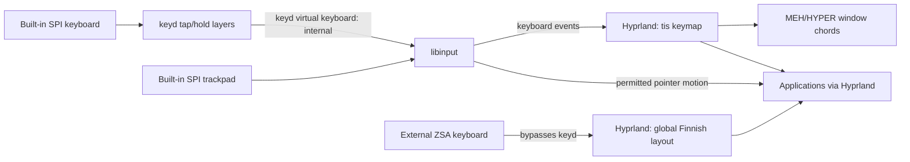

# MBP Built-in Keyboard Layout

**Status:** MKL-001 deployed; MKL-002 installer tested, fresh-session typing check pending
**Created:** 2026-11-18
**Last updated:** 2026-11-27

## Engineering Profile

Stable defaults live in [PROFILE.md](PROFILE.md). Current-cycle overrides: risk
`routine`, delivery intent `draft_pr` (feature branch + draft PR into `main`;
durable delivery is `chezmoi apply` on mbp-omarchy after merge). MKL-002
covers how libinput identifies the remapped keyboard for the built-in trackpad.

## Overview

One software keyboard stack for the mbp-omarchy built-in keyboard: Colemak-DH
via XKB with Finnish ä/ö typed directly, displaced punctuation relocated to an
AltGr cluster, tap/hold layers (HYPER, MEH, arrows, backslash) via keyd, and a
Touch Bar default of media controls with F1–F12 on fn. Everything ships through
this chezmoi repository; no firmware or other machine changes.

Problem being solved:

- ä/ö today require holding Right-Alt to flip into a second Finnish XKB group
  (`grp:ralt_switch`), which also burns Right-Alt as a group switch.
- The `colemak_dh_ortho` variant maps both LSGT (`<>` key) and the z key to `z`
  on this ISO keyboard — a literal duplicate z.
- The AltGr level of the Finnish group carries never-used symbols
  (`¡ºª¢€ħðþ…`) while `[ ] { } '` need new homes after ä/ö take their keys.
- Hyper/Meh chords in `bindings.lua` exist but have no comfortable physical
  source; the Touch Bar shows the opposite of the wanted default layer.
- Brushing the trackpad while typing can move the pointer: the built-in
  keyboard reaches libinput through a virtual device, so enabling “disable
  while typing” in Hyprland alone does not identify the typing source.

## File Map

| Path | Purpose |
|------|---------|
| `private_dot_config/hypr/input.lua.tmpl` | mbp branch: built-in devices and keyd's virtual keyboard load the custom keymap via `kb_file` |
| `private_dot_config/xkb/keymap/tis.xkb` | Self-contained keymap source (`xkb_keymap` directives with `include` over system `us(colemak_dh_ortho)`); loaded directly by Hyprland, no compiled artifact or regen script |
| `run_always_mbp-keyboard-layers.sh.tmpl` | Installs keyd, owns the keyboard's libinput section and persists Touch Bar fn policy; host- and terminal-gated |
| `tests/test_mbp_keyboard_layout.py` | Tests the rendered profile, input mappings and real append/adopt/conflict behavior on temporary files |

## Visual Evidence

| Concern | Decision |
|---|---|
| Boundary | `required: Context/container flowchart` — which input layer owns mapping, and which decides whether to suppress trackpad movement? |
| Interaction | `not_applicable: prose Given/When/Then scenarios below` |
| State | `required: transition table` — the [trackpad contract](#trackpad-protection-while-typing) distinguishes create, adopt and conflict |
| Data/trust | `not_applicable: the privileged installer writes local device metadata; this feature records no input events` |
| Schema | `not_applicable: no persistent entities` |
| Dependency/deployment | `not_applicable: delivery is one chezmoi apply; the boundary chart covers the only topology` |
| Quantitative | `not_applicable: no decision depends on measured data` |



**Text Equivalent:** Built-in keyboard events (device `apple-spi-keyboard`)
flow through keyd, which owns tap/hold resolution and modifier layers.
Libinput identifies keyd's virtual keyboard as internal and can suppress new
trackpad contacts during typing. It forwards allowed motion and keyboard events
to Hyprland, which applies the custom single-group XKB keymap (base
`us(colemak_dh_ortho)`, Finnish keys and AltGr cluster added, LSGT duplicate
fixed) before delivering symbols to applications. Hyprland keybinds consume
MEH/HYPER chords produced by keyd unchanged. External keyboards bypass keyd
(device-scoped) and keep the untouched global Finnish layout, since the ZSA
firmware already owns their Colemak-DH.

Source and owner: this context's keyboard installer and Hyprland input template.
Update the diagram when device selection, typing suppression or keymap ownership changes.

## Domain

### Bounded Context

Personal Linux input remapping for one laptop. Adjacent: `omarchy_try`
input template branch in the same file (must stay byte-identical), the macOS
AeroSpace keymap reference ([`docs/keymap.md`](../../keymap.md)), and the ZSA
Oryx firmware layout (external authority, see OD-1).

For trackpad protection, `mbp_keyboard_layout` owns the rule because it
introduces the virtual keyboard. [`host_tool_maintenance`](../host_tool_maintenance/features/omarchy-mbp-install.md#daily-driver-post-install-2026-11-16)
owns host installation and links here for input qualification. Libinput owns
the suppression algorithm; Hyprland supplies its existing “disable while typing”
setting. No pointer speed, palm thresholds, external keyboard mappings or guest
input settings change.

### Ubiquitous Language

| Term | Definition |
|------|-----------|
| built-in keyboards | The `apple-spi-keyboard` device (and `at-translated-set-2-keyboard` fallback) named in `input.lua.tmpl` |
| HYPER | Ctrl+Alt+Shift+Super chord; physical source: Caps Lock held |
| MEH | Ctrl+Alt+Shift chord; physical source: space held |
| arrows layer | keyd layer active while right Cmd is held |
| AltGr cluster | Level-3 bindings of the custom keymap, home for displaced punctuation |
| LSGT | ISO `<>` key left of left Shift |
| ZSA parity | Final pass aligning symbol placement with the Moonlander Oryx layout |

## Behavior Scenarios

### Feature: Finnish letters typed directly

**Scenario: ä and ö without group switching**
- Given the mbp built-in keyboard is active with the custom keymap
- When `[` is tapped, then `ä` is produced; with Shift, `Ä`
- When `'` is tapped, then `ö` is produced; with Shift, `Ö`
- When Right-Alt is held, it selects AltGr symbols, not a Finnish group

**Scenario: Swedish å is out of scope**
- Given any input
- Then no key or layer produces `å`; the operator never uses it

### Feature: Displaced punctuation on AltGr

**Scenario: cluster lookup**
- Given AltGr is held
- When `7 8 9 0` are tapped, then `{ [ ] }` are produced
- When `[` is tapped, then `[`; when `'` is tapped, then `'`
- And the AltGr number row never yields the legacy `¡ºª¢€ħðþ…` set

### Feature: Quote and pipe relocation

**Scenario: double quote moves to backslash key**
- Given the custom keymap is active
- When `\` is tapped, then `\`; with Shift, `"`

**Scenario: ZSA-style grave key — pipe on tap, tilde on hold**
- Given keyd layers are active
- When the grave key is tapped, then `|`; with AltGr, `` ` ``
- When the grave key is held past 200 ms, then `~`
- And `|` also stays on AltGr+`\` in the keymap

### Feature: Markdown key on the ISO `<>` key

**Scenario: backtick tap, code fence hold**
- Given keyd layers are active
- When the `<>` key (LSGT) is tapped, then `` ` ``
- When it is held past 200 ms, then ``` ``` ``` is typed for a code fence
- And the letter `z` is untouched (one physical z key only)

### Feature: Displaced angle brackets on comma and dot

**Scenario: comma and dot hold**
- Given keyd layers are active
- When `,` is tapped, then `,`; held, `<`
- When `.` is tapped, then `.`; held, `>`

**Scenario: question mark from holding slash**
- When `/` is tapped, then `/`
- When `/` is held past 200 ms, then `?` (Shift+`/` tap also gives `?`)

### Feature: Modifier layers

**Scenario: Caps Lock is HYPER**
- Given Caps Lock is held
- Then all keys emit Ctrl+Alt+Shift+Super chords, driving the existing
  `SUPER+CTRL+SHIFT+ALT+<n>` move-window binds with zero bind edits

**Scenario: space hold is MEH**
- Given space is tapped and released quickly, then a space is emitted
- When space is held ≥ 200 ms, then keys emit Ctrl+Alt+Shift chords, driving
  the existing `CTRL+SHIFT+ALT+<n>` workspace-switch binds

**Scenario: right Cmd is the arrow layer**
- Given right Cmd is held
- When the keys at Colemak `n e i o` positions (raw keycodes `j k l ;`) are
  tapped, then ← ↓ ↑ → are produced in any focused application
- And left Cmd and Caps Lock remain the window Super keys

### Feature: Duplicate z removed

**Scenario: LSGT no longer z**
- Given the custom keymap is active
- When LSGT is tapped, then `<`; with Shift, `>`
- And exactly one physical key produces `z`

### Feature: Touch Bar default layer

**Scenario: media by default, F-keys on fn**
- Given the Touch Bar policy is applied
- Then the bar shows device/media controls by default
- When fn is held, the bar shows F1–F12

### Feature: The pointer stays still while typing (MKL-002)

- Given a fresh graphical session with “disable while typing” enabled, when
  the operator types ordinary letters on the built-in keyboard and **then**
  brushes the trackpad, the new touch does not move the pointer.
- When typing stops, the palm is lifted and the brief suppression interval
  passes, a deliberate new finger movement moves the pointer at its usual speed.

## Contracts & Invariants

### Custom keymap `tis` (XKB)

| Key (XKB code) | Level 1 | Level 2 (Shift) | Level 3 (AltGr) |
|---|---|---|---|
| `[` (AD11) | ä | Ä | `[` |
| `'` (AC11) | ö | Ö | `'` |
| `\` (BKSL) | `\` | `"` | `\|` |
| `` ` `` (TLDE) | `\|` | `~` | `` ` `` |
| LSGT (`<>` key) | `` ` `` | `<` | reserved (OD-1) |
| `7`/`8`/`9`/`0` | unchanged | unchanged | `{` `[` `]` `}` |
| all other keys | inherit `us(colemak_dh_ortho)` | | |

- **Invariant:** letter map equals `colemak_dh_ortho` everywhere except LSGT;
  ZXCV positions are preserved.
- **Invariant:** no keycode produces `z` other than the z key.

### keyd `/etc/keyd/mbp.conf`

| Binding | Action |
|---|---|
| `[ids]` | `05ac:0341:89b7fedc` — the built-in SPI keyboard node only (keyd ids are prefix matches with no glob syntax; the uid suffix excludes the same-id SPI trackpad) |
| `capslock` | `layer(hyper)`; `[hyper:C-M-A-S]` |
| `space` | `overloadt(meh, space, 200)`; `[meh:C-A-S]` |
| `rightmeta` | `layer(arrows)`; arrows layer maps `j k l ;` → left/down/up/right |
| `slash` | `timeout(slash, 200, S-slash)`: tap `/`, hold `?` |
| `grave` | `timeout(grave, 200, S-grave)`: tap `\|`, hold `~` |
| `102nd` (LSGT) | `timeout(102nd, 200, macro(102nd 102nd 102nd))`: tap `` ` ``, hold types ``` ``` ``` |
| `comma` / `dot` | `timeout(..., 200, S-...)`: tap `,`/`.`, hold `<`/`>` |

keyd re-emits all built-in keyboard events through its own `keyd virtual
keyboard` uinput device, so Hyprland's custom keymap must also bind that
device (see the template contract below).

### Trackpad protection while typing

On the `omarchy` profile with a hostname starting `mbp-omarchy`, the keyboard
installer owns **one section** of `/etc/libinput/local-overrides.quirks`:

```ini
[MacBook remapped keyboard]
MatchUdevType=keyboard
MatchName=keyd virtual keyboard
AttrKeyboardIntegration=internal
```

The literal match is on keyd's **output**, not the physical SPI device, keyd
pointer, Espanso or other virtual keyboards. This is correct only while keyd's
`[ids]` selects the built-in keyboard alone; revisit the rule if that changes.

| Given | When the keyboard installer runs | Result |
|---|---|---|
| No local file, or only unrelated sections | Apply from a terminal | Create the directory/file if missing, or append the section once; preserve existing bytes, including an unterminated last line. |
| The same section was installed by hand or by a previous apply | Apply again | Adopt it without rewriting the file. Comments, blank lines and key order do not require replacement. |
| The named section differs or occurs twice | Apply from a terminal | Report the conflict and stop; leave the file intact for the operator to reconcile. |
| Another machine profile, or a noninteractive run | Apply | No libinput write; the existing host and terminal gates apply. |

**Text Equivalent:** The MBP keyboard installer adds a missing section, adopts
one matching section, and refuses to overwrite a conflict. Other profiles and
noninteractive runs skip it. Update this table when the installer's ownership or
conflict policy changes.

Preview with `chezmoi apply --dry-run "$HOME/always_mbp-keyboard-layers.sh"`.
From a terminal on the MBP, omit `--dry-run` to deploy. **Log out and back in**
to start a fresh libinput context. Check `hyprctl getoption input:touchpad:disable_while_typing`
is true and perform the two typing scenarios above. File presence and a passing
render test do not establish physical palm rejection.

To roll back, revert the installer change **first** so the next apply does not
restore it. Use `sudoedit /etc/libinput/local-overrides.quirks` to remove only
`[MacBook remapped keyboard]` and its settings, then log out and back in.

### Template contract

- **Pre:** `input.lua.tmpl` `omarchy-try` branch and the global Finnish base
  are byte-identical before and after this work; non-mbp Omarchy machines keep
  today's `us,fi` device entries.
- **Post:** the mbp branch references the custom keymap via `kb_file` for
  exactly three device entries — `apple-spi-keyboard`,
  `at-translated-set-2-keyboard`, and `keyd virtual keyboard`; `run_always`
  scripts are idempotent and no-op on other machines.

### Rollback

Removing the keyd conf, keymap reference, and fn policy restores today's
`us,fi` + `grp:ralt_switch` behavior; no data or firmware is touched.

## Gate Ledger

**[MKL-002 applicability plan](MKL-002.plan.json)** (profile: `PROFILE.md`; routine, draft PR). No requested exceptions.

| Gate | Applicability | Status | Evidence / remaining check |
|---|---|---|---|
| Domain, Behavior, Spec, Contract | Required | Documented | Owner, typing scenarios, exact device match and shared-file contract above. |
| Test-driven implementation, Refactor | Required | Locally tested | Rendered shell and temporary-file tests for fresh install, adoption, repeated applies, conflicts and off-host isolation. |
| Review/Integrate | Required | Pending | Review and CI on the candidate for `main`. |
| Release | Not applicable | — | Host configuration; no versioned package. |
| Deploy | Required | Pending | Terminal apply and physical typing check after a fresh login. |
| Operate | Not applicable | — | Libinput runs in the existing compositor; no new daemon or ongoing operator job. |
| Maintain/Retire | Required | Documented | Recheck keyd's device scope if its mapping changes; section-only rollback above. |

**MKL-001 historical results:**

| Gate | Capability | Applicability | Result | Authority/evidence | Exception | Owner |
|---|---|---|---|---|---|---|
| Development Kernel | required | required | passed | pytest (890-891 passed across rounds) + render contracts; gate commits `1c55820`, `85e93c8`, `2c5c8ff`, `4413434` | — | operator |
| Review | required | required | passed | diff coherence across rounds + full-suite evidence at final head; operator matrix acceptance | — | operator |
| Integrate | required | required | passed | base reconciliation merge with `origin/main` (clean auto-merge, union validation green); PR 3-way merge into `main` | — | operator |
| Release | not_applicable | not_applicable | — | no versioned artifact; chezmoi apply delivers | — | — |
| Deploy | required | required | passed | live on mbp: keyd matched the SPI keyboard, tis keymap active on keyd virtual keyboard, `configerrors` clean, `fnmode=3`, tiny-dfr `MediaLayerDefault=true`; operator matrix (ä/ö, brackets, HYPER/MEH, arrows, ```` ``` ````, `?`, Touch Bar) | — | operator |
| Operate | not_applicable | not_applicable | — | keyd/tiny-dfr are distro-packaged services | — | — |
| Maintain | required | required | passed | edit keymap source directly (no compiled artifact); OD-1 residue tracked in backlog for the Oryx parity pass | OD-1 deferred: LSGT AltGr slot + final ZSA sweep pending operator Oryx export | operator |
| Retire | not_applicable | not_applicable | — | rollback contract above | — | — |

## Artifact Review

- README: created (this document).
- BACKLOG: created; indexed in `docs/BACKLOG.md`.
- CHANGELOG: created; completion entry required at cycle close.

## Verification

```bash
# Static (repo root)
uv run --group test pytest tests/            # full suite, incl. other machines
chezmoi apply --dry-run --source .           # mbp data renders; omarchy-try diff empty

# Live (mbp-omarchy, after apply)
sudo keyd monitor                # walk every tap/hold mapping incl. Shift+hold-/
hyprctl devices                 # built-ins + keyd virtual keyboard on the tis map
hyprctl configerrors            # clean
cat /sys/module/hid_apple/parameters/fnmode   # 3 (media first; 1 is F-keys first)
grep MediaLayerDefault /etc/tiny-dfr/config.toml   # true — tiny-dfr owns the strip
systemctl is-active keyd tiny-dfr
```

Manual matrix: ä Ä ö Ö on `[`/`'`; `{ [ ] }` and `'` on AltGr; `\` `" `` ` `` `~`
`|` per the table; tap `/` vs hold `/` vs Shift+hold `/`; Caps+2 and
space-hold+2 move/switch workspace via existing binds; right-Cmd+`neio` arrows
in a terminal and a GUI editor; Touch Bar default vs fn-held layers; ZSA on the
mbp still types its firmware layout.

## Gotchas

- keyd resolves tap/hold below XKB: bind by raw keycode (`j k l ;`), not by
  Colemak glyph; the ZSA (firmware layout) equivalent would be `n e i o`.
- `overloadt` (timeout-resolved) is required for space — plain `overload` fires
  the layer the moment a rolled key press lands while space is down.
- Right Cmd is consumed by the arrows layer and no longer acts as Super;
  left Cmd and Caps Lock remain Super/HYPER sources.
- keyd runs as a system daemon: its conf is deployed via the sudo-gated
  `run_always` script pattern, not plain chezmoi files.
- keyd `[ids]` are literal prefix matches (`strstr(id, pattern) == id`), not
  globs: `05ac:0341*` matches nothing. Use the full `vendor:product:uid`
  (journal prints it); a bare `vendor:product` would also match the SPI
  trackpad, which keyd grabbing would break.
- keyd actions emit KEYCODES, not glyphs: bind to the key whose XKB level
  carries the wanted symbol (`S-grave` → `~` because TLDE shift is `~`;
  the `grave` keycode no longer types a backtick after the remap — that is
  why LSGT's fence macro fires `102nd` three times).
- keyd has no tap-dance/double-tap detection; hold timeouts and two-key
  chords are the only multi-press primitives.
- Omarchy's Lua config tree parses at Hyprland start; `hyprctl reload`
  does not re-execute `input.lua`. Live preview without restarting the
  session: `hyprctl eval 'hl.device({...})'`; a fresh session picks the
  file up natively.
- `git hash-object` dereferences symlinks, so `dbsctrctl gate-commit`
  cannot carry symlink paths; base reconciliation therefore rides the
  PR 3-way merge (verified auto-mergeable) instead of a branch merge.

## Facts, Assumptions, Risks, Open Decisions

**Facts (verified 2026-11-18/19)**

- Current mbp template state: `us,fi` + `colemak_dh_ortho` + `grp:ralt_switch`.
- `colemak_dh` maps LSGT→z and the ortho override re-adds z on the z key
  (upstream comment: LSGT absent on ANSI boards) → duplicate on ISO.
- keyd 2.6.0-5 is in `extra` for aarch64; `xkbcli` present on the mbp.
- Touch Bar runs tiny-dfr 0.3.7 (active). Two independent layers, both
  live-verified: tiny-dfr's `MediaLayerDefault` decides the rendered strip
  (packaged default `false` = F-keys shown — the "stuck" symptom); fnmode
  only decides keycodes (`fnmode=1` is F-keys-first, `3` is media-first).
  Policy: `/etc/tiny-dfr/config.toml` with `MediaLayerDefault = true`
  (merged over the packaged template) plus `fnmode=3`, both persisted by
  the run script. tiny-dfr tracks fn through the DFR virtual input device,
  which keyd ignores, so fn-layer switching survives the keyboard grab.
- Built-in keyboard input ids: bus 001c, vendor 05ac, product 0341
  (`Apple SPI Keyboard`); no separate `at-translated` device exists on the mbp.
- Omarchy's Hyprland build forwards `kb_file` in `hl.device` (binary device
  field whitelist, alongside `keybinds`/`share_states` already used here).
- keyd re-emits events through its `keyd virtual keyboard` uinput device;
  `timeout(action1, T, action2)` is the hold-emits-keycode primitive (v2.6.0
  man page), and `[shift]` modifier-layer routing is supported.

**Assumptions**

- 200 ms tap/hold default is acceptable (tunable without spec change).
- ZSA Oryx exports (screenshots/share link) will arrive for OD-1; the firmware
  `.bin` in Downloads is compressed and not a readable layout source.

**Risks**

- Typing-roll misfires on space-hold (mitigated by timeout variant; tunable).
- Hold-to-emit on `/` can misfire on slow deliberate `/` presses (isolated
  hold past 200 ms emits `\`); tunable, and rolls are protected because an
  intervening key resolves the tap.
- keyd char macros assume a US symbol table; all keyd emissions use raw
  keycodes (`backslash`, `S-backslash`) so the custom XKB levels stay authoritative.

**Open decisions**

- **OD-1 (partially applied 2026-11-19)** Final `~`/`|` placement and LSGT
  AltGr slot, from Moonlander Oryx screenshots (ZSA parity pass). Operator
  memory already applied: grave tap `|` / hold `~`, LSGT `` ` ``/``` fence,
  `,`/`.` holds for `<`/`>`. Screenshots still welcome to settle the LSGT
  AltGr slot and anything else.
- **OD-2 (resolved 2026-11-19)** Keymap delivery: `kb_file` via `hl.device` —
  the Omarchy Hyprland build forwards it (device field whitelist); fallback
  `~/.config/xkb` rules overlay not needed. Verified live at Deploy.
- **OD-3 (resolved 2026-11-19)** Shift+hold-/ emits `"` via
  `[shift] slash = timeout(slash, 200, S-backslash)`; `|` remains on
  AltGr+`` ` `` and AltGr+`\` in the keymap. Live `keyd monitor` walk at Deploy
  confirms timing feel.
