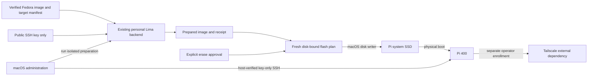

# Raspberry Pi bootstrap

## Overview and boundaries

Bring up a Raspberry Pi 400 headlessly with Fedora Minimal on an external USB SSD,
Ethernet DHCP, owner-key SSH, then Tailscale enrollment. The macOS administrator
launches a existing personal Lima Fedora VM to prepare ext4 filesystems; existing
Omarchy and Fedora Parallels guests are excluded from image preparation. Workloads
and desktop installation are deferred. Target identity comes from homelab_topology;
user configuration ownership stays with existing chezmoi profiles.
Engineering defaults: PROFILE.md. Method 3.29; current delivery is Discovery only.
The future disk-write slice is critical risk and is not yet approved or registered.

## Domain, inputs and baseline

Target, BaseImage, PreparedImage, PreparationReceipt, PreparationBackend, DiskIdentity,
FlashPlan and BootEvidence are distinct values. BaseImage is immutable upstream
input; PreparedImage contains reviewed first-access configuration and its own
checksum. FlashPlan binds target identity and prepared-image digest. PreparationBackend
has a verified identity and isolated staging files, image loop devices and mounts. Credentials and
hardware endpoints are private local bindings, not source manifest values.

Observed Fedora input: Minimal 44 build 1.7 aarch64. Compressed SHA-256:
`aebf1cb693fbdbd45837980b3be6becbd34c321ff937c49e582244eaa2f48aaf`.
It matches the official published checksum; signature authentication has not yet
been established. Prior read-only inspection found FAT EFI plus ext4 boot/root,
SSH and NetworkManager enabled, and interactive initial-setup enabled. No prepared
image exists yet. No disk writes have been made by this workflow.

The owner selected existing personal-sandbox Lima Fedora 44 ARM64 as preparation
backend. The maintained macOS entry point owns preparation steps and private
staging artifacts; it does not own VM creation, shutdown, removal or service
lifecycle. Backend capabilities and image provenance are checked before preparing.

## Behaviors and interfaces

- Given verified base input and a declared Pi target, preparation creates a
  separate bootable candidate with owner tis, approved public key, DHCP, enabled
  SSH and noninteractive initial setup; it never copies a private key.
- Given unavailable prerequisites or invalid integrity, preparation fails before
  disk mutation and reports a bounded actionable error.
- Given the approved personal Lima backend, preparation verifies its identity and
  capabilities and isolates owned image mounts; existing services remain running.
- Given a reviewed flash plan, flashing requires fresh physical-disk identity and
  explicit matching approval; identity or artifact changes invalidate the plan.
- Given normal chezmoi apply, no disk is written and no helper is launched.
- Given first boot, SSH is key-only with root login disabled, SELinux remains
  enforcing, and Tailscale enrollment uses an operator-local authentication step.
- Given successful first SSH, health checks and a fresh reboot establish persistent
  access before application configuration is considered.
- Given failed USB boot, report firmware/media uncertainty; do not declare success
  from image preparation or networking alone.

Proposed interfaces: `pi-bootstrap plan`, `prepare`, `flash`, `verify`. Manifest
holds target ID, board, base-image identity, public-key input reference, network
policy, helper bounds and filesystem-growth policy. Private disk identity and key
path are supplied locally. Flash is never an apply script or automatic retry.

## Security, recovery and validation contracts

Verify publisher provenance and artifact hashes. Review all privileged helper
commands, restrict mounts to input/output artifacts, and exclude host home/SSH
private-key directories. Physical writes run on macOS against freshly identified
external whole disks; never trust a remembered disk number. Default is plan-only.
Retain image/manifest/receipt identity locally for boot evidence and recovery.
Each device must receive distinct SSH host identity, with its fingerprint bound to
prepared-image provenance or another trusted verification channel before login.
Network reachability alone is not host authentication.

Approved administrative policy: require the owner password for sudo while
keeping SSH key-only. Collect that password privately during preparation, store
only its salted verifier in the target account, and never put password/verifier
in Git, process arguments or logs. Prepared images contain authentication data
and must remain private local artifacts. The owner approved password-required
sudo. Preparation backend sudo is requested interactively when needed. Tailscale node credentials
are enrolled after initial SSH and never baked into a distributable image.
Retain manual lock/power/recovery options; this context does not configure apps.

Owner reports no SSD data to preserve and no spare microSD. USB boot from this drive has not been attempted. Firmware USB capability remains
unverified. Recovery may require obtaining a microSD; no purchase is authorized.
There is no promise of rollback after flashing. Re-preparation/reflash is recovery
for this empty target, not recovery for writing the wrong disk. Preserve all other
disks, VMs, applications and credentials.

Required checks: image signature/hash, helper isolation and mount/resource limits,
headless account/auth configuration, filesystem labels and SELinux, boot firmware,
partition growth, fresh disk-identity validation, explicit approval invalidation,
SSH host verification, local network access, enrollment and fresh reboot.
No prepared-image tests, physical boot or deployment have occurred. Backend
read-only preflight verified Fedora 44 ARM64, 52GB free and required filesystem
tools. Backend sudo requires interactive authentication; do not weaken policy.
Fedora 44 image metadata records support end 2027-05-19; review upgrades before EOL.

## Visual Evidence

Boundary and dependency/deployment: required flow diagram below. Interaction and
state: required operation sequence table. Data/trust: required flow diagram with
public-key/private-key and approval boundaries. Schema: not_applicable until
manifest/receipt schema is finalized. Quantitative: not_applicable; no measured
capacity or performance comparison is claimed.
Canonical sources: this contract, target declaration and future preparation
receipt. Operator owns updates; change visuals with trust/operation boundaries.

**Text Equivalent:** Verified Fedora input, declarations and public key enter a
approved personal Lima preparation backend launched from macOS. Private keys
are excluded from preparation inputs; existing services remain running. Helper produces a prepared image and receipt. A fresh physical-disk plan
plus explicit consent allows macOS to write SSD. Pi must physically boot and pass
host-verified SSH checks; Tailscale enrollment is a separate operator step.

| Operation / state | Guard and expected evidence |
|---|---|
| plan | No mutation; display provenance, target and prerequisites |
| prepare | Isolated image work in personal Lima; produce immutable receipt and digest |
| flash | Current disk identity and artifact-bound consent; verified write |
| first boot | Physical USB boot plus DHCP and key-only SSH evidence |
| enroll | Private operator Tailscale authentication; no baked node state |
| verify | Fresh reboot retains administration access; reconcile owned staging/mount cleanup |

## Gate Ledger and Build handoff

| Gate | Applicability | Result |
|---|---|---|
| Domain, Behavior, Spec, Contract | required | pending; Discovery draft only |
| Test, Refactor, Review/Integrate | required | not_run |
| Release, Deploy, Operate, Maintain/Retire | required by prepared-image and target lifecycle | not_run |

No Gate Exceptions approved. Open: backend
capability preflight and publisher provenance, exact manifest/receipt
schema and publisher-signature authority. First Build slice must not flash until
its tool, candidate image and target-bound erase plan are concretely reviewable.

## Concrete preparation artifact contract

The maintained macOS entry point will be `dot_local/bin/executable_pi-bootstrap`.
Its reviewed backend steps will be `dot_local/lib/pi-bootstrap/prepare.sh` and
its non-secret target/image policy `private_dot_config/pi-bootstrap/manifest.json`.
The topology declaration owns the logical `pi400` target; private image paths,
key paths, disk identities and authentication inputs are local arguments/state.
None of these artifacts is a chezmoi `run_` script.

The backend is existing `personal-sandbox` Lima, not a newly created disposable
VM. The script verifies backend architecture/OS/tools, prepares a separate image
in a unique private staging directory, uses only owned loop devices/mounts, and
cleans those resources on success/failure. It never stops/deletes the VM or
changes existing Atuin/PostgreSQL containers, privileges or data. Root access
inside the backend is interactive; no sudo password enters arguments or logs.

Image preparation consumes publisher-authenticated Fedora input and approved
public key. It configures owner password-required sudo, key-only SSH, Ethernet
DHCP, noninteractive initial setup, enforcing SELinux and deferred target growth.
Password input is private and omitted from the public manifest and receipt.
Outputs are a private prepared image and a public-safe provenance/verification
receipt; sensitive host-identity evidence remains local. Paths and permissions
are validated before every privileged command. Exact preparation checks precede
any disk write. No replay of a prepare receipt grants flash permission.

Implementation delivery is split into image preparation and a later explicit
flash/boot slice. The latter has fresh physical-disk plan and separate consent.
It remains critical risk even though the operator reports no SSD data to keep.
