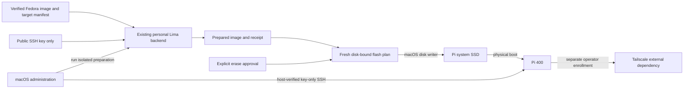
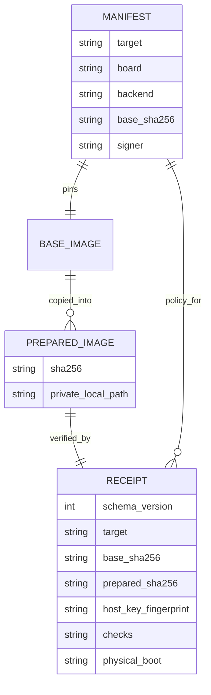

# Raspberry Pi bootstrap

## Overview and boundaries

Bring up a Raspberry Pi 400 headlessly with Fedora Minimal on an external USB SSD,
Ethernet DHCP, owner-key SSH, then Tailscale enrollment. The macOS administrator
uses the existing personal Lima Fedora VM to prepare ext4 image files; existing
Omarchy and Fedora Parallels guests are excluded from image preparation. Workloads
and desktop installation are deferred. Target identity comes from homelab_topology;
user configuration ownership stays with existing chezmoi profiles.
Engineering defaults: PROFILE.md. Method 3.29; PI-BOOTSTRAP-PREPARE-001 owns the approved preparation slice.
The future disk-write slice is critical risk and is not yet approved or registered.

## Domain, inputs and baseline

Target, BaseImage, PreparedImage, PreparationReceipt, PreparationBackend, DiskIdentity,
FlashPlan and BootEvidence are distinct values. BaseImage is immutable upstream
input; PreparedImage contains reviewed first-access configuration and its own
checksum. FlashPlan binds target identity and prepared-image digest. PreparationBackend
has a verified identity and isolated private staging files and extracted ext4 partition copies. Credentials and
hardware endpoints are private local bindings, not source manifest values.

Observed Fedora input: Minimal 44 build 1.7 aarch64. Compressed SHA-256:
`aebf1cb693fbdbd45837980b3be6becbd34c321ff937c49e582244eaa2f48aaf`.
It matches the official published checksum. Its cleartext signature was verified
with Fedora 44 fingerprint `36F612DCF27F7D1A48A835E4DBFCF71C6D9F90A6`,
matched against the Fedora security page. Prior read-only inspection found FAT EFI plus ext4 boot/root,
SSH and NetworkManager enabled, and interactive initial-setup enabled. Private prepared images are verified locally; identities remain in private receipts. No disk writes have been made by this workflow.

The owner selected existing personal-sandbox Lima Fedora 44 ARM64 as preparation
backend. The maintained macOS entry point owns preparation steps and private
staging artifacts; it does not own VM creation, shutdown, removal or service
lifecycle. Backend capabilities and image provenance are checked before preparing.

## Behaviors and interfaces

- Given verified base input and a declared Pi target, preparation creates a
  separate bootable candidate with owner tis, approved public key, DHCP, enabled
  SSH and noninteractive initial setup; it never copies a private key.
- Given unavailable prerequisites or invalid integrity, preparation fails before
  disk mutation and reports a bounded actionable error.
- Given the approved personal Lima backend, preparation verifies its identity and
  capabilities and isolates owned image files without mounts; existing services remain running.
- Given a reviewed flash plan, flashing requires fresh physical-disk identity and
  explicit matching approval; identity or artifact changes invalidate the plan.
- Given normal chezmoi apply, no disk is written and no helper is launched.
- Given first boot, SSH is key-only with root login disabled, SELinux remains
  enforcing, and Tailscale enrollment uses an operator-local authentication step.
- Given successful first SSH, health checks and a fresh reboot establish persistent
  access before application configuration is considered.
- Given failed USB boot, report firmware/media uncertainty; do not declare success
  from image preparation or networking alone.

Proposed interfaces: `pi-bootstrap plan`, `prepare`, `flash`, `verify`. Manifest
holds target ID, board, base-image identity, public-key input reference, network
policy, helper bounds and filesystem-growth policy. Private disk identity and key
path are supplied locally. Flash is never an apply script or automatic retry.

## Security, recovery and validation contracts

Verify publisher provenance and artifact hashes. Review all backend
commands, restrict edits to owned input/output artifacts, and exclude host home/SSH
private-key directories. Physical writes run on macOS against freshly identified
external whole disks; never trust a remembered disk number. Default is plan-only.
Retain image/manifest/receipt identity locally for boot evidence and recovery.
Each device must receive distinct SSH host identity, with its fingerprint bound to
prepared-image provenance or another trusted verification channel before login.
Network reachability alone is not host authentication.

Approved administrative policy: require the owner password for sudo while
keeping SSH key-only. Collect that password privately during preparation, store
only its salted verifier in the target account, and never put password/verifier
in Git, process arguments or logs. Prepared images contain authentication data
and must remain private local artifacts. The owner approved password-required
sudo. No backend sudo is used: its deny policy remains intact. Tailscale node credentials
are enrolled after initial SSH and never baked into a distributable image.
Retain manual lock/power/recovery options; this context does not configure apps.

Owner reports no SSD data to preserve and no spare microSD. USB boot from this drive has not been attempted. Firmware USB capability remains
unverified. Recovery may require obtaining a microSD; no purchase is authorized.
There is no promise of rollback after flashing. Re-preparation/reflash is recovery
for this empty target, not recovery for writing the wrong disk. Preserve all other
disks, VMs, applications and credentials.

Required checks: image signature/hash, helper isolation and staging/resource limits,
headless account/auth configuration, filesystem labels and SELinux, boot firmware,
partition growth, fresh disk-identity validation, explicit approval invalidation,
SSH host verification, local network access, enrollment and fresh reboot.
Prepared-image tests and host script deployment passed; physical Pi boot and disk deployment remain unverified. Backend
read-only preflight verified Fedora 44 ARM64, 52GB free and required filesystem
tools. Backend sudo policy explicitly denies general commands. Existing debugfs permits
unprivileged offline ext4 editing, so preparation requires no backend sudo.
Do not weaken the sandbox policy. macOS flashing still requires separate sudo.
Fedora 44 image metadata records support end 2027-05-19; review upgrades before EOL.

## Visual Evidence

Boundary and dependency/deployment: required flow diagram below. Interaction and
state: required operation sequence table. Data/trust: required flow diagram with
public-key/private-key and approval boundaries. Schema: required manifest/image/receipt entity diagram below. Quantitative: not_applicable; no measured
capacity or performance comparison is claimed.
Canonical sources: this contract, target declaration and future preparation
receipt. Operator owns updates; change visuals with trust/operation boundaries.

**Text Equivalent:** Verified Fedora input, declarations and public key enter a
approved personal Lima preparation backend launched from macOS. Private keys
are excluded from preparation inputs; existing services remain running. Helper produces a prepared image and receipt. A fresh physical-disk plan
plus explicit consent allows macOS to write SSD. Pi must physically boot and pass
host-verified SSH checks; Tailscale enrollment is a separate operator step.

| Operation / state | Guard and expected evidence |
|---|---|
| plan | No mutation; display provenance, target and prerequisites |
| prepare | Isolated image work in personal Lima; produce immutable receipt and digest |
| flash | Current disk identity and artifact-bound consent; verified write |
| first boot | Physical USB boot plus DHCP and key-only SSH evidence |
| enroll | Private operator Tailscale authentication; no baked node state |
| verify | Fresh reboot retains administration access; reconcile owned staging cleanup |

## Gate applicability and delivery boundary

All Development Kernel and completion gates are required. The private Cycle
Record owns current gate results and evidence; this README defines stable
acceptance criteria. No Gate Exceptions are approved.

Preparation must authenticate publisher provenance, pass isolated filesystem
and full-image integration checks, and produce an owner-password candidate
with a verified private receipt. Installation must preserve existing backend
services. Physical flashing and Pi boot verification belong to the later
critical-risk slice, with a fresh disk-bound erasure approval. Integration-test
images use disposable credentials and must never be flashed as the owner image.

## Concrete preparation artifact contract

The maintained macOS entry point is `dot_local/bin/executable_pi-bootstrap`.
Its reviewed backend steps are `dot_local/lib/pi-bootstrap/prepare.sh` and
its non-secret target/image policy `private_dot_config/pi-bootstrap/manifest.json`.
The topology declaration owns the logical `pi400` target; private image paths,
key paths, disk identities and authentication inputs are local arguments/state.
None of these artifacts is a chezmoi `run_` script.

The backend is existing `personal-sandbox` Lima, not a newly created disposable
VM. The script verifies backend architecture/OS/tools, prepares a separate image
in a unique private staging directory, uses unprivileged debugfs on extracted private partition copies, and
leaves failed artifacts private for diagnosis. No loop device, mount or chroot is used. It never stops/deletes the VM or
changes existing Atuin/PostgreSQL containers, privileges or data. No backend root access is requested. Owner password entry is private stdin,
not arguments or logs.

Image preparation consumes publisher-authenticated Fedora input and approved
public key. It configures owner password-required sudo, key-only SSH, Ethernet
DHCP, noninteractive initial setup, enforcing SELinux and deferred target growth.
Password input is private and omitted from the public manifest and receipt.
Outputs are a private prepared image and a public-safe provenance/verification
receipt; sensitive host-identity evidence remains local. Paths and permissions
are validated before image modification. Exact preparation checks precede
any disk write. No replay of a prepare receipt grants flash permission.

Implementation delivery is split into image preparation and a later explicit
flash/boot slice. The latter has fresh physical-disk plan and separate consent.
It remains critical risk even though the operator reports no SSD data to keep.

## Preparation v1 interface and contract

The macOS CLI supports `plan --image PATH --key PUBLIC_KEY`,
`prepare --image PATH --key PUBLIC_KEY --output NEW_DIRECTORY`, and
`verify --output DIRECTORY`. Manifest and backend may be selected explicitly for
source-checkout validation; installed defaults are under ~/.config/pi-bootstrap
and ~/.local/lib/pi-bootstrap. Flash is intentionally unavailable in this slice.

The manifest pins Fedora 44 Minimal 1.7 compressed filename, SHA-256, publisher
checksum URL, public key URL and signing fingerprint; target pi400, board rpi400,
backend personal-sandbox, owner tis/UID 1000, Ethernet DHCP and password-required
sudo. Unknown fields and policy changes fail closed. No secret or host endpoint
belongs in the manifest. Public key accepts only one valid ed25519 public key;
private-key input is rejected before file transfer. The declared Pi target must
exist in the installed homelab inventory and be a personal physical ARM64 target.

`plan` reads prerequisites, source identity, and backend identity without image
mutation. `prepare` verifies publisher signature and compressed hash, then copies
only reviewed backend files, image, and public key to a new mode-0700 backend
staging directory. It asks for the Pi owner password twice using getpass on the
operator terminal. Password is sent over Lima's existing SSH transport as stdin,
never command arguments or a temporary plaintext file. Backend uses openssl's
salted SHA-512 crypt verifier; only shadow contains it. Prepared images are mode
0600 private artifacts, not distributable or source-controlled.

Backend uses existing sfdisk, debugfs, e2fsck, openssl and ssh-keygen. It decompresses
and validates the expected MBR geometry, extracts the root partition, checks it,
then edits regular ext4 files without mounts, sudo, chroot or service changes.
It creates tis home/account/group, appends wheel membership, installs key-only
sshd policy, password-required sudo rule, unique SSH host key, disables interactive
initial-setup, clears machine identity and enables first-boot filesystem growth.
New inodes receive explicit owner/mode; enforcing SELinux and first-boot relabel
are retained. A reviewed one-shot first-boot unit expands root partition three
and ext4 within the Pi, never an administrator-host disk. Its disk/partition is
resolved from the live root filesystem and validated as partition three.

Before joining the edited root partition into a separate raw candidate, run
read-only e2fsck and inspect account, SSH, sudo, first-boot unit and public-key
attributes. The backend receipt binds base and prepared SHA-256, target, policy,
verification checks and unique host-key fingerprint. Host retrieves image/receipt,
checks prepared hash again and marks files 0600. No existing output directory is
reused. Failed runs remain private with an actionable stage identifier; explicit
cleanup removes only the operator-reviewed staging directory after staging
verification, never the VM, services or arbitrary parent trees.

Verification establishes preparation integrity only. Physical USB firmware,
DHCP, SSH authentication, relabel completion, root growth and fresh reboot remain
required in the later flash/boot slice. First boot may take longer for relabeling;
do not interpret an initial SSH delay as failed boot. Retain private prepared
artifacts until successful boot/reboot, then at most seven days unless operator
chooses a protected recovery copy. Reimage requires a newly reviewed disk plan.

**Text Equivalent:** Public policy pins the publisher-authenticated base image.
Each preparation makes a private candidate and receipt binding target, input/output
hashes, host-key fingerprint and verification checks. Password and salted verifier
are absent from the receipt. Physical boot remains unverified until the later
flash/boot slice. Canonical sources are manifest, CLI and backend receipt contract;
operator owns updates when policy or artifact interfaces change.

## Flash and headless boot v1 contract

This slice extends the maintained macOS CLI with explicit `flash-plan --output
PREPARED_DIRECTORY --disk /dev/diskN --plan NEW_PRIVATE_FILE` and
`flash --plan PRIVATE_FILE --approve-plan SHA256`. Creating a plan is read-only
apart from its new private plan file. Chezmoi installs the command but never
invokes it automatically. Root execution is requested only in the operator
terminal, with sudo password hidden; no password belongs in chat or arguments.

A FlashPlan binds schema version, logical target, verified prepared-image path,
byte count and SHA-256, current external whole-disk identity, media name, exact
capacity, USB attachment path, device node, and original disk-header fingerprint.
It records a bounded expiry and its canonical digest. Serial numbers, connection
endpoints and actual device identities remain local. The plan is immutable;
changes to image, receipt, device or approval digest invalidate it. All ordinary
host/internal disks, undersized targets, unexpected media and non-whole-disk
nodes are rejected before any unmount or write. The fresh observed StoreJet
must be selected explicitly; a remembered BSD disk number is not authority.

Given a valid plan and matching approval, the command revalidates input and
fresh disk identity, unmounts only that disk, and rechecks identity before
opening its raw whole-disk node. It writes exactly the candidate image length,
flushes writes, reads back that same byte range and compares SHA-256. It writes
a private receipt only after verification succeeds, then ejects the target for
physical handoff. Any failure is non-success; no automatic retry or alternative
disk selection is allowed. Partial-write recovery is a new verified plan and
reflash of the same reviewed target. There is no rollback of erased content;
the owner reports no target data to preserve. All other disks and VMs remain
untouched.

Given the verified flash receipt, the owner connects the SSD and Ethernet to the
Pi 400 and powers it on. The administrator discovers a candidate through local
DNS/DHCP/router observations, requests only its public SSH host key, and compares
its fingerprint with trusted preparation receipt before adding a dedicated
private known-hosts entry. SSH never disables host checking. Initial-setup must
be noninteractive, login must use the existing owner SSH key, and root/password
SSH must remain disabled. Private keys stay on macOS.

Headless success requires observed aarch64 Fedora identity, expected Pi board,
USB-backed root filesystem, completed SELinux relabel, successful root-growth
unit and disk capacity, enabled SSH/network services, and key-only login.
Password-required sudo is verified privately in the owner's terminal. A fresh
reboot must preserve SSH access and filesystem identity before completion.
Tailscale enrollment is an explicit owner authentication step after local SSH;
no reusable auth key is baked into image or public state. Physical USB boot
firmware remains an unverified runtime prerequisite, not a readiness promise.
If USB boot fails, diagnose Ethernet/power/firmware evidence and report the
possible need for microSD recovery media; never purchase or alter another device.

Validation uses failing boundary tests before implementation: internal/partition
or wrong-media disk rejection, stale image/device/header/expiry/approval mismatch,
partial write and readback mismatch, and no mutation on invalid input. A regular
file simulation verifies streaming and readback without access to real disks.
Configured Python 3.12–3.14 tests, chezmoi isolation, source review and real
operator-authorized StoreJet verification cover deployment. Physical boot and
fresh SSH/reboot evidence remain required, and failures cannot be converted to
passes. The existing flow diagram and operation table cover flash/boot trust
boundaries; this section is their canonical contract extension.
