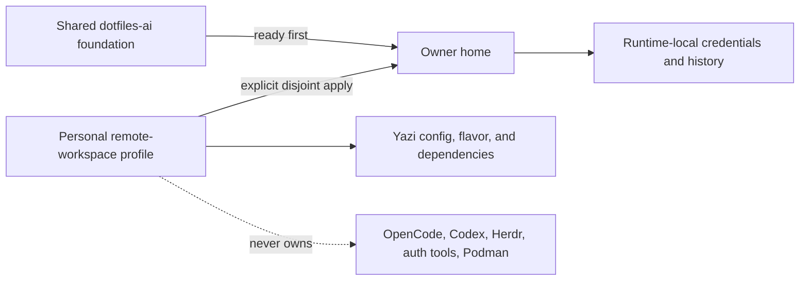

# Remote Workspace Profile

> The [RRW-007B owner expansion](OWNER_EXPANSION.md) supersedes the historical
> Yazi-only scope below: included Git identity/F02 preservation, four pinned
> tools, a private parser-build CLI, locked first-open AstroNvim, portable Bash
> snippets and a separate prompt config. The overlay remains optional and
> disjoint; source approval does not authorize live rollout or apply.

## Outcome

The owner may explicitly apply a narrow Yazi-only overlay after the shared
`dotfiles-ai` foundation is ready. The overlay derives only the Yazi portion of
the existing `lmsh` allowlist for the intended RHEL 10 x86_64 successor. This is
approved successor Discovery, not implementation or deployment evidence; release
qualification remains pending. Shared `dotfiles-ai` retains Bash, Atuin,
Starship, OpenCode, Codex, Herdr, gcloud, 1Password,
Podman, and bootstrap ownership.

The stable Engineering Profile is [`PROFILE.md`](PROFILE.md).

## RRW-002B Successor Overrides

| Field | Value |
|---|---|
| Initiative / slice / cycle ID | `rhel-remote-workspace` / `rrw-002b-rhel-owner-overlay` / `RRW-002B` (not registered) |
| Risk | Elevated: executable installation into an owner home on a shared remote host |
| Delivery intent | Normal PR approval without admin bypass; local disposable userland proof only, with actual RHEL owner qualification and private rollout separate |
| Scope | Explicit `machine_type=remote-workspace` after the shared foundation; Yazi-only targets and installed files remain disjoint |
| Dependency | Source preparation is independent of `rrw-002-rhel-user-runtime`; final paired qualification uses its exact reviewed runtime SHA, and shared readiness precedes live owner apply |
| Compatibility | Immutable release/checksum/flavor pins and existing macOS/`lmsh` rendering remain unchanged |

Only the standalone CentOS target is superseded. Historical RWUE-003 evidence
retains its original platform. Shared tools remain user-local; optional UBI10
Toolbx adds no new containerized toolchain or personal ownership. Both users are
intended shared-foundation targets, but this overlay remains owner-only. Colleague
readiness is unverified until their shared foundation is independently exercised; no owner
credentials or personal state may be copied.

The coordinator manifest is still pending. Use an exact reviewed shared-source
revision for disposable target-overlap proof; report the merged RRW-002 runtime
SHA for final paired qualification and live owner apply. Readiness and gate
applicability/results remain pending. This Discovery authorizes no source change; a regression found
during approved Build work is the only basis for an in-scope source correction.
Staging, OpenShell, MarimoHub, and infrastructure changes remain out of scope.

## Domain

- `RemoteWorkspaceProfile`: explicit `machine_type=remote-workspace` intent.
- `SharedFoundation`: the authoritative public `dotfiles-ai` managed-target set.
- `PersonalOverlay`: owner-only Yazi configuration, flavor, and portable Yazi
  dependency installation.
- `TargetAllowlist`: deny-by-default Yazi subset derived from the existing
  `lmsh` role.

## Behavior

### Explicit owner apply

- **Given** the shared foundation is ready for the owner
- **When** the owner initializes and applies `machine_type=remote-workspace`
- **Then** only the approved Yazi allowlist is managed
- **And** no infrastructure or shared-agent target changes ownership.

### Another user does not receive personal state

- **Given** another OS Login user receives the shared foundation
- **When** their first-login bootstrap converges
- **Then** this personal source is not cloned or applied
- **And** no owner account, endpoint, history, key, or credential is projected.

### Ownership collision

- **Given** rendered managed-target sets from both sources
- **When** any path appears in both sets
- **Then** validation fails before apply
- **And** neither source transfers ownership automatically.

### Safe rollback

- **Given** the owner applied the personal overlay
- **When** the overlay rolls back or is removed
- **Then** the prior managed-target manifest is restored
- **And** Atuin history, authentication, keys, and unrelated files remain intact.

### Successor qualification stays evidence-specific

- **Given** disposable userland with the shared foundation
- **When** render, apply, idempotency, disjointness, and rollback pass in
  `registry.access.redhat.com/ubi10/ubi`
- **Then** the result is UBI10 userland smoke only
- **And** it does not qualify a full RHEL VM, SELinux, rootless Podman, systemd,
  IAP, or either user's actual remote readiness.

- **Given** a separately approved actual RHEL 10 x86_64 owner qualification
- **And** the foundation uses the full public merged runtime SHA supplied by the
  primary
- **When** the shared foundation is ready and the owner explicitly exercises the
  Yazi overlay
- **Then** owner results are recorded separately from disposable smoke and
  private rollout
- **And** no colleague readiness is inferred from owner evidence.

## Interfaces And Contracts

- Add `remote-workspace` as an explicit machine type; do not infer it from host,
  username, employer, client, architecture, or repository path.
- Add an explicit `remote-workspace` allowlist containing only Yazi package and
  theme configuration, the locked flavor installer, and portable Yazi runtime
  dependencies. Bash, common profile, Atuin, and Starship remain excluded.
- Support x86_64 with reviewed release assets and SHA-256 checksums. Installed
  binaries must also be disjoint from the shared foundation's installed files.
- Keep release, checksum, and flavor pins immutable; a mutable branch, tag, or
  placeholder is not the required full public merged foundation runtime SHA.
- Applying the overlay is explicit and user-owned; root bootstrap and private
  workspace infrastructure do not map an OS Login identity to this repository.
- The shared remote client is IAP-only without a Tailscale requirement; remote
  Atuin remains local-only and preserves history. Neither contract transfers
  targets into this overlay or changes unrelated macOS/Fedora Lima behavior.

## Visual Evidence

| Concern | Decision | Review question | Canonical source |
|---|---|---|---|
| Boundary | `required: target ownership flowchart` | Which source owns each target? | Outcome and Interfaces And Contracts |
| Interaction | `not_applicable` | Explicit apply follows standard chezmoi interaction | Behavior |
| State | `not_applicable` | Shared bootstrap owns readiness state | Remote-development contract |
| Data/trust | `required: target ownership flowchart` | Where may personal endpoint and credentials exist? | Interfaces And Contracts |
| Schema | `not_applicable` | Existing scalar TOML data is sufficient | Interfaces |
| Dependency/deployment | `required: target ownership flowchart` | Why must shared readiness precede personal apply? | Explicit owner apply |
| Quantitative | `not_applicable` | No quantitative decision exists | Validation |

The existing view covers source ownership and shared-foundation-before-overlay
ordering, unchanged by the RHEL successor. Owner: personal dotfiles owner; update
the view and Text Equivalent when target ownership, prerequisite ordering, or
trust boundaries change. No additional platform diagram is needed.

**Text Equivalent:** The public foundation applies first and owns Bash, Atuin,
Starship, agent runtimes, authentication tooling, and Podman helpers. The owner
then explicitly applies a deny-by-default personal subset containing only Yazi
configuration, flavor, and portable dependencies. Credentials and history
remain outside personal source state. Validation rejects any rendered or
installed target overlap.

## Validation

- Run the full repository pytest suite.
- Render every existing macOS and `lmsh` profile plus `remote-workspace`.
- Compare exact rendered and installed target sets from both sources and require
  empty intersections.
- Parse rendered TOML, verify x86_64 checksums and executable versions, and prove
  a second apply is empty.
- Prove rollback preserves local history, keys, auth state, and unrelated files.
- Run disposable userland smoke in `registry.access.redhat.com/ubi10/ubi`; retain
  eventual actual RHEL owner qualification as separate evidence. Neither proves
  colleague readiness or authorizes private rollout.

## Historical RWUE-003 Source Implementation

These source facts and pins describe the predecessor, not RHEL qualification.

- `machine_type=remote-workspace` renders only Yazi `package.toml`, `theme.toml`,
  the flavor installer, and the remote-workspace Yazi installer.
- The installer places checksum-verified Yazi and `ya` 26.8.15, fd 10.5.0,
  fzf 0.74.3, and 7-Zip 26.02 x86_64 binaries in `~/.local/bin` without root.
- The official Catppuccin Mocha flavor remains revision- and hash-locked in
  `package.toml`; Bash, Atuin, Starship, agents, authentication, Podman, and
  bootstrap remain outside the overlay.

## RRW-002B Gate Candidates

The primary must verify applicability in the committed Build plan; these are
Discovery candidates, not registered gates or results. Actual RHEL owner
qualification and private rollout remain outside local disposable proof.

| Gate | Candidate applicability | Result |
|---|---|---|
| Domain | required | pending |
| Behavior | required | pending |
| Spec | required | pending |
| Contract | required | pending |
| Test-driven implementation | required; regression evidence governs any source correction | pending |
| Refactor | required | pending |
| Review/Integrate | required | pending |
| Release | not_applicable: no versioned artifact | not_run |
| Deploy | required: disposable userland apply only | pending |
| Operate | required: disposable userland smoke only | pending |
| Maintain/Retire | required: idempotency, preservation, and rollback | pending |

## Readiness

Historical RWUE-003 source implementation was complete under its approved
Initiative receipt; that acceptance is not RHEL evidence. RRW-002B readiness is
pending coordinator authority and primary verification of the successor contracts
and applicability plan. The full public merged runtime SHA is required for final
paired qualification and live owner apply, not independent source preparation.
No source implementation, gate pass, actual owner qualification, or deployment is
claimed by this Discovery. Owner apply remains explicit after shared readiness.
